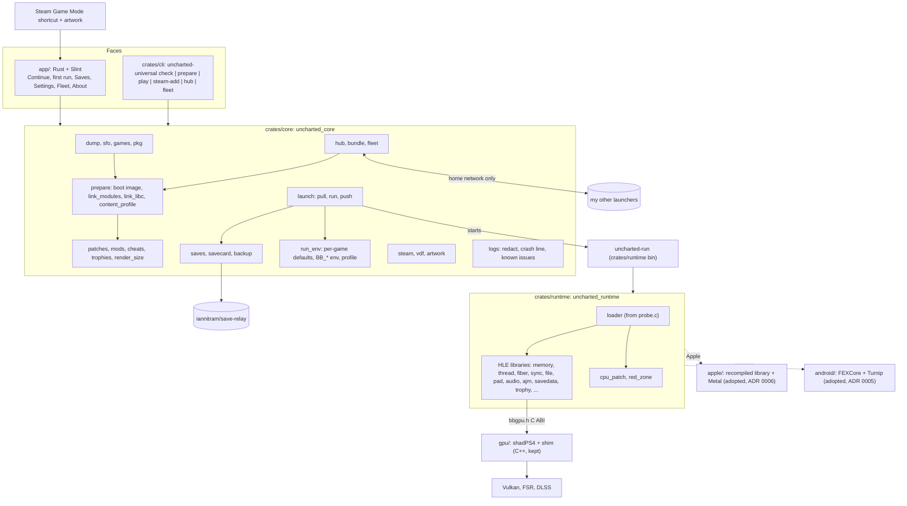

# Code map: Uncharted Universal

The intended shape of the repo for 1.0 (`SPEC.md`, approved 2026-11-01): **one Rust engine, two faces, one Rust runtime, three hubs, five platforms**. The engine (`crates/core`, library `uncharted_core`) checks my dump, prepares each game's install (boot image, linked modules, patches, render size), serves it to my other devices over the home network, writes the Steam shortcut with artwork, and wraps every start in a save-relay pull and push. The runtime (`crates/runtime`, `uncharted_runtime`) is the host side of the port, replacing `src/*.c` module by module (ADR 0002); it hands GNM work to the vendored shadPS4 renderer in `gpu/` (C++, kept) through `gpu/bbgpu.h`. The faces are the Slint launcher (`app/`, ADR 0003) and the `uncharted-universal` command line (`crates/cli`). Android runs the game's x86-64 code through FEXCore (ADR 0005); Mac, iPhone and iPad run a library recompiled on the Mac, drawn with Metal (ADR 0006).

Status per module: **present** (built), **stub** (the final types and signatures exist; constants and trivial pure helpers may be built, and any other function returns `Err(Error::NotBuilt(..))` or panics with "not built yet" when it cannot fail), **planned** (not in the tree), **legacy** (today's C or Python, removed when its Rust replacement is present and the game boots). An issue that builds a module moves its status in the same PR. Integration branch: `main` (our work; `upstream-main` is a copy of Supermedo's `main`).

## Platforms (R04)

| Device family | 1.0 device | Game code | Renderer | Built on (hub) | Launcher | Save sync in | CI |
|---|---|---|---|---|---|---|---|
| Linux / SteamOS | the AMD handheld, the Strix Halo tablet | native x86-64 | shadPS4, Vulkan (RADV) | the Strix Halo tablet; the AMD handheld pulls | Slint app (AppImage), opened by the Steam shortcut | the launcher | `ubuntu-latest`: workspace, GPU library, boot smoke |
| Windows | the RTX 3090 Ti desktop | native x86-64 | shadPS4, Vulkan | the desktop | Slint app | the launcher | `windows-latest`: workspace, GPU library (CLANG64) |
| macOS | a Mac with Apple silicon | recompiled library | Metal | the Mac | Slint app (also builds and installs the iOS app) | the launcher | `macos-latest`: workspace; Apple runtime cross-build |
| iOS / iPadOS | iPhone or iPad + controller | recompiled library (no JIT) | Metal | the Mac, installed by cable | none: the game app | the game app (save-relay C interface) | `macos-latest`: iOS target builds |
| Android | Adreno device + controller | FEXCore (x86-64 to ARM64) | shadPS4, Vulkan (Turnip) | the Strix Halo tablet | Slint app (Android) | the launcher, inside the same app | `ubuntu-latest`: `aarch64-linux-android` cross-build |

Rules that keep it portable: `crates/core` is pure Rust (no C library, no OpenSSL; the hub's crates are `mdns-sd`, RustCrypto `spake2`, `chacha20poly1305`, `sha2`, behind feature `hub`); no `std::os::*` outside `platform`, `steam` and the runtime's `os` module; every OS rule takes its folders from `platform::Vars`, so Linux, Windows and Mac rules are tested on every runner; tests build temporary folders under `std::env::temp_dir()`. The runtime is the only crate with `unsafe` and FFI, and each `unsafe` block carries a `// SAFETY:` line.

## How it fits together



## Modules: `crates/core` (`uncharted_core`)

| Module | Status | Owns | Replaces | Musts |
|---|---|---|---|---|
| `error` | present | `Error` with stable `code()` and plain message per variant, `NotBuilt`, `Result` | | all |
| `platform` | stub | `Os` (linux, windows, mac, ios, android), `Vars` (home, data, config from env lookup), `AppDirs` (`<config>/uncharted-universal`, `<data>/uncharted-universal`: installs, backups, logs) | `launcher/bbport_assets.py` paths | M7, M11 |
| `sfo` | stub | `param.sfo` reader: `parse` to keys (`TITLE_ID`, `APP_VER`, `VERSION`, `TITLE`), never writes | `scripts/patches.py` `sfo()` | M11 |
| `games` | stub | `Game` (U1, U2, U3), title ids (`CUSA02320`, `CUSA02343`, `CUSA02344`, `CUSA02826`) to game and region, `SUPPORTED` revisions per game, `check_revision` (plain refusal) | `NDC_IDS` in `patches.py` | M11 |
| `pkg` | stub | `.pkg` extractor: entry table, bounded copies, overlap refusal | `scripts/pkg.py` | M11 |
| `dump` | stub | `DumpReport`, `check` (folder layout, decrypted or not, which games and revisions), the early check before a prepare | `#172` dump check | M11 |
| `content_profile` | stub | the content profile values per title (`sceAppContentAppParamGetInt`) | `scripts/content_profile.py` | M7 |
| `link` | stub | `link_modules` and `link_libc`: module and libc import tables for the boot image | `scripts/link_modules.py`, `scripts/link_libc.py` | M7 |
| `prepare` | stub | `prepare` a game folder into an install: boot image, linked modules, patches, render size; returns `InstallManifest` | `scripts/prepare.py` | M7, M11 |
| `patches` | stub | third-party patches per executable (`APP_VER` and title decide), parse, apply, list for About | `scripts/patches.py` | M7, M8 |
| `mods` | stub | mod folder layouts (`dvdroot_ps4`, `app0/...`), overlay list for the runtime's file VFS | `scripts/mods.py` | M7 |
| `cheats` | stub | cheat file parse and apply | `scripts/cheats.py` | M7 |
| `trophies` | stub | trophy data read for the runtime | `scripts/trophies.py` | M7 |
| `render_size` | stub | render-size patches (540p up, 720p Deck mode) by byte pattern | `scripts/render_res.py`, `scripts/render_720p.py` | M5, M13 |
| `run_env` | stub | per-game defaults (`fix_defaults`) and the `BB_*` environment from settings and the device profile | `run.py` | M5, M7 |
| `profile` | stub | `DeviceProfile` (amd-handheld 20 W 30/60 Hz, strix-halo-tablet, desktop, mac, ios, android), `detect`, `by_id` | Deck mode in `uncharted_linux.py` | M5, M13 |
| `saves` | stub | savedata root per game per device, what travels, `relay_manifest` for save-relay | | M4, M18 |
| `savecard` | stub | `SaveCard` (game, slot, picture from the save's `sce_sys/icon0.png`, title and detail from its `param.sfo`, file time, device, build id), `latest`, `side_by_side` | | M10 |
| `backup` | stub | `backup_saves`, `list`, `prune` (keep 10) | | M19 |
| `update` | stub | back up, re-prepare, recount saves | `uncharted_launcher.py` update check | M19 |
| `launch` | stub | `Relay` and `Runner` traits, `play` (pull, conflict with both `SaveCard`s, run `uncharted-run` with `run_env`, push) | `run.py` main | M7, M10, M18 |
| `logs` | stub | `redact` (no game paths or hex keys in logs), the `Crash:` line, `known_issues.json` matcher, `playthrough.jsonl` | `launcher/uncharted_logs.py`, #168-#170 | M1-M3, M9 |
| `recipe` | stub | `Target` (linux, windows, mac, ios, android), `Hub` (strix-halo, desktop, mac), `hub_for`, `serves` | | M11 |
| `bundle` | stub | `Bundle` (target, build id, patch level, files with size and SHA-256, shader translations), `manifest`, `verify`, `install`; never the dump folder (a test enforces it) | | M11, M12 |
| `hub` | stub (feature `hub`) | `discover` (mDNS `_uncharted-universal._tcp`, private ranges only), `pair` (six-digit code, SPAKE2), `serve`, `pull` (sealed, resumable), `Transport` trait for loopback tests | | M12 |
| `fleet` | stub | `DeviceRecord`, `drift` warning | | M12 |
| `vdf` | stub | Steam binary KeyValues `read`, `write` | `launcher/bbport_steam.py` | M13 |
| `steam` | stub | `shortcut_app_id`, `Shortcut`, `upsert`, `userdata_roots`, `write_shortcut` (Steam closed, `.bak` kept), `write_artwork` | `launcher/bbport_steam.py`, `uncharted_art.py` | M13 |
| `artwork` | stub | Steam grid, hero, logo, icon from each game's `sce_sys/pic0.png`, `pic1.png`, `icon0.png`; nothing downloaded | `launcher/uncharted_art.py` (SteamGridDB download dropped) | M13 |
| `relay` | planned (feature `relay`) | save-relay adapter: links its library, maps outcomes to `launch::Sync` | #163 | M18 |

`vdf`, `steam`, `platform`, `bundle`, `hub`, `fleet` and the shape of `savecard` are copied from iannitram/totk-native (MIT) with credit in the file header, once built there.

## Modules: `crates/runtime` (`uncharted_runtime`)

Built as a static library linked into the loader binary while C remains; each Rust module exports the same `extern "C"` symbols as the C file it replaces (header generated by `cbindgen` into `crates/runtime/include/`). Order (ADR 0002): leaves first, loader last. Each step keeps `bash build.sh` and the boot smoke test green.

| Module | Status | Replaces (lines) | Tests from | Order |
|---|---|---|---|---|
| `abi` | stub | `src/runtime.h`, `src/runtime.c` (266): the C ABI, NID resolution table (`import_names.inc`), `runtime_resolve` | `test_runtime.c` | 1 |
| `time`, `rtc` | planned | `runtime_time.c` (29), `runtime_rtc.c` (155) | `test_runtime.c` parts | 2 |
| `sync` | planned | `runtime_sema.c` (185), `runtime_mutex.c` (263), `runtime_rwlock.c` (162) | `test_sema.c`, `test_sema.py` | 3 |
| `content`, `display` | planned | `runtime_content.c` (91), `runtime_display.c` (143) | `test_content.c`, `test_display.c` | 4 |
| `trophy` | planned | `runtime_trophy.c` (327) | | 5 |
| `savedata` | planned | `runtime_savedata.c` (431) | | 6 |
| `audio` | planned | `runtime_audio.c` (323), `runtime_speakers.h` | `test_speakers.c` | 7 |
| `ajm` | planned | `runtime_ajm.c` (707) | `test_ajm.c` | 8 |
| `file` | planned | `runtime_file.c` (631): VFS, mod overlay | `test_file_mods.c` | 9 |
| `pad` | planned | `runtime_pad.c` (1235): SDL3 pad, gyro, rumble | `test_pad.c` | 10 |
| `services`, `kernel` | planned | `runtime_services.c` (678), `runtime_kernel.c` (351) | | 11 |
| `memory` | planned | `runtime_memory.c` (970): direct and flexible memory, mapping | | 12 |
| `fiber`, `thread` | planned | `runtime_fiber.c` (363), `runtime_thread.c` (494) | | 13 |
| `cpu_patch`, `red_zone` | planned | `cpu_patch.c` (591), `red_zone.c` (489) | `test_cpu_patch.c`, `test_red_zone.c` | 14 |
| `os` | planned | `compat_win.c` (162): the MinGW POSIX shims become `cfg(windows)` code | | 15 |
| `loader` + bin `uncharted-run` | planned | `probe.c` (1474): ELF mapping, imports by NID, hooks, faults, MOVBE emulation | `test_probe.py`, the boot smoke | 16 |
| `gpu` (build script) | planned | `build.sh` GPU part: builds `gpu/` with CMake through the `cmake` crate, links `bbgpu` | `test_*.cpp` stay C++ | with 1 |

`src/vulkan_smoke.c` becomes a test in `gpu`'s build. When `loader` is present, `src/` is deleted (M20).

## Faces

| Path | Status | Owns | Replaces | Musts |
|---|---|---|---|---|
| `crates/cli` (`uncharted-universal`) | stub | `check`, `prepare`, `play <game>`, `steam-add`, `patches`, `hub serve/pair/pull`, `fleet` | `run.py` command line | M7, M11, M12 |
| `app/` (`uncharted-app`) | planned | the launcher, Rust + Slint, Linux, Windows, macOS, Android; links `uncharted_core` | `launcher/*.py` | M7, M10-M13, M15, M17 |
| `app/src/vm/` | planned | view models: `continue_page`, `first_run`, `saves`, `settings` (display cards from auto-tune #174), `fleet`, `about`, `after_crash` (#176) | | M10 |
| `app/src/input.rs` | planned | `Nav` from gilrs (desktop) and Android key events | | M10 |
| `app/ui/` | planned | `.slint` pages, controller first; texts in Slint's translation files (from `uncharted_i18n*.py`, `bbport_lang*.py`, seven languages) | `launcher/uncharted_widgets.py`, i18n files | M10 |
| `docs/design/continue-screen.md` | planned | the Continue screen brief, shared with totk-native, for three games | | M10 |

## Adopted code (stays in its own language)

| Path | Status | From | Owns |
|---|---|---|---|
| `gpu/` | present | shadPS4 (pinned, `VENDOR.txt`) + the port's shim | GNM to Vulkan, shader recompiler, host passes, FSR, DLSS |
| `android/` | planned | revvv991/uncharted-android (GPL-2.0, credited) | APK project, FEXCore and Mesa/Turnip patches, libadrenotools glue, the `g2-arm64:` renderer changes rebased onto ours |
| `apple/` | planned | bloodborne-native/bloodborne-runtime, -mac, -ios (GPL-2.0, licence read at the issue, credited) | the x86-64 recompiler run on the Mac from my dump, the Metal renderer, the iOS app shell with controller and touch |

## Legacy (removed by M20)

| Path | Removed when |
|---|---|
| `launcher/` (Python/Tk, about 11k lines), `launcher/bb-launcher.sh` | the Slint app has parity: Continue, first run, Settings, Add to Steam, update |
| `scripts/*.py`, `run.py`, `run.sh` | every `crates/core` module listed above is present |
| `src/*.c`, `src/*.h` | `crates/runtime::loader` is present and the game boots |
| `packaging/windows/` PyInstaller, `packaging/linux/package.sh` | the release workflow builds the Rust app |
| `tests/*.py`, C tests in `tests/` | their Rust ports are present |

## Build and test

```sh
git submodule update --init --recursive
cargo build --workspace                 # core, cli, runtime (builds gpu/ through cmake), app
cargo test --workspace
bash build.sh && bash build.sh --test   # the C path, until src/ is gone
```

CI: `.github/workflows/check.yml` (fmt, clippy, build, test on Linux, Windows, macOS; cross-builds for `aarch64-linux-android`, `aarch64-apple-ios`) and `build.yml` (the Linux package and release from `main`, until the Rust release workflow replaces it).

## Build hubs (ADR 0004)

| Hub | Prepares for | Clients |
|---|---|---|
| the Strix Halo tablet | linux, android | the AMD handheld, the Android device |
| the RTX 3090 Ti desktop | windows | itself |
| the Mac | mac, ios | itself; the iPhone or iPad by cable |

A bundle holds the prepared install (boot image, linked modules, patches, the game data folder) and the GPU-independent shader translations; a driver pipeline cache travels only between devices with the same GPU and driver. Nothing leaves the home network.

## Not verified yet

- Which revision (`APP_VER`) of each game the port supports today; `games::SUPPORTED` is filled from the device runs.
- Whether a PS4 save's `sce_sys/icon0.png` and `param.sfo` give a useful picture and detail for the save card; fallback: the game's own `icon0.png`.
- bloodborne-native's recompiler and Metal renderer: how much is Bloodborne-specific, and their licence files (`apple/` issue 8.01).
- FEXCore performance with our Rust runtime on Android (revvv991 measured the C runtime).
- mDNS from Game Mode and on Android (multicast lock).
