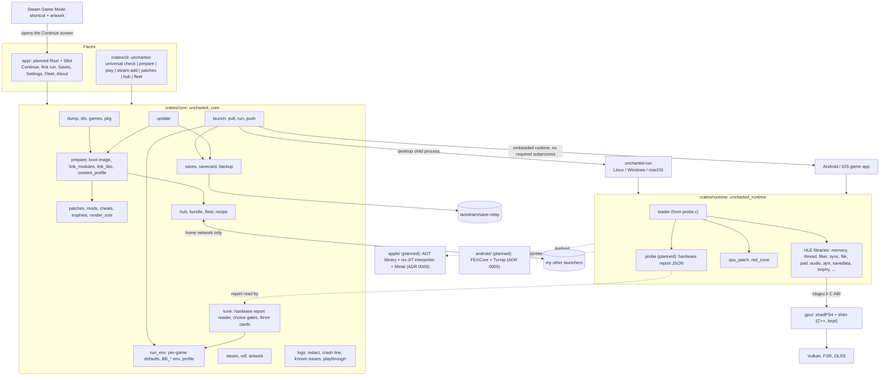

# Code map: Uncharted Universal

The intended shape of the repo for 1.0 (`SPEC.md`, approved 2026-11-01): **one Rust engine, two faces, one Rust runtime, three hubs, five platforms**. Our launcher, preparation tools, core and host runtime are Rust. The adopted graphics engine stays C++ behind `gpu/bbgpu.h`; its language boundary is intentional. Linux and Windows execute x86-64 game code natively. The planned Apple route is an ARM64 library generated by AOT recompilation of x86-64 guest code, with an interpreter fallback and Metal; feasibility remains gated by #211 and iOS has no JIT. Android runs x86-64 game code through FEXCore on ARM64. The engine (`crates/core`) and faces (`app/` and `crates/cli`) describe the approved design, not a claim that those workflows are implemented.

Status per module: **present** (implemented in the tree), **partial** (only named functions/metadata exist; remaining behavior is listed), **stub** (types/signatures exist but behavior is `NotBuilt` or unimplemented), **planned** (not in the tree), **legacy** (today's C or Python, removed when its Rust replacement is present and the game boots). Synthetic tests exercise stated test seams only; they do not prove device or game behavior. "Musts" columns cite `SPEC.md` (M1-M20; the spec has no Should items); every module that replaces C or Python also serves M20. An issue that implements a module moves its status in the same PR. Integration branch: `main` (our work; `upstream-main` is a copy of Supermedo's `main`).

Source baseline: production `main` at [`ef27c862`](https://github.com/iannitram/Uncharted-Universal/tree/ef27c862dd15f60e64c51a1d285b96dec1be13b9); former upstream `8b66edc` is already its ancestor. The target architecture below includes planned work: runtime ABI version is still 0, `crates/runtime/build.rs` is absent, and `app/`, `android/` and `apple/` do not exist. The CLI is a skeleton; `recipe::recipe_for`, preparation, linking, install and launch are stubs. Rust test fixtures and source-level checks do not establish Android, Apple, or full-game execution. See the [platform readiness audit](audits/2026-11-06-universal-platforms.md) and [PEERS.md](../PEERS.md).

## Platforms (R04)

| Device family | 1.0 device | Game code | Renderer | Built on (hub) | Launcher | Save sync in | CI |
|---|---|---|---|---|---|---|---|
| Linux / SteamOS | the AMD handheld, the Strix Halo tablet | native x86-64 | shadPS4, Vulkan (RADV) | the Strix Halo tablet; the AMD handheld pulls | Slint app (AppImage), opened by the Steam shortcut | the launcher | `[self-hosted, linux]`: Rust workspace; legacy Linux package in build.yml; integrated GPU/boot smoke pending (3.01) |
| Windows | the RTX 3090 Ti desktop | native x86-64 | shadPS4, Vulkan | the desktop | Slint app | the launcher | `[self-hosted, windows]`: Rust workspace; full GPU/runtime build pending (6.01) |
| macOS | a Mac with Apple silicon | planned ARM64 library generated from x86-64 guest code; interpreter fallback | Metal | the Mac | Slint app (also builds and installs the iOS app) | the launcher | `macos-latest`: workspace on workflow_dispatch only; explicit runtime/application build pending (8.02); runner architecture must be verified |
| iOS / iPadOS | iPhone or iPad + controller | planned ARM64 library generated from x86-64 guest code; no-JIT interpreter fallback | Metal | the Mac, installed by cable | none: the game app | the game app (save-relay C interface) | `macos-latest`: runtime cargo check on workflow_dispatch only; signed application build pending (8.02) |
| Android | Adreno device + controller | FEXCore (x86-64 to ARM64) | shadPS4, Vulkan (Turnip) | the Strix Halo tablet | Slint app (Android) | the launcher, inside the same app | `[self-hosted, linux]`: runtime static-library cross-build; NDK/GPU/APK link pending (7.02) |

Rules that keep it portable: `crates/core` is pure Rust (no C library, no OpenSSL; the hub's crates are `mdns-sd`, RustCrypto `spake2`, `chacha20poly1305`, `sha2`, behind feature `hub`); no `std::os::*` outside `platform`, `steam` and the runtime's `os` module; every OS rule takes its folders from `platform::Vars`, so Linux, Windows and Mac rules are tested on every runner; tests build temporary folders under `std::env::temp_dir()`. The runtime is the only crate with `unsafe` and FFI (`crates/core` has `#![forbid(unsafe_code)]`), and each `unsafe` block carries a `// SAFETY:` line. Anything that must call a C library (the Vulkan hardware probe, SDL) lives in the runtime and reaches `crates/core` as data (a JSON report) or through a trait, never as a call.

## How it fits together



## Modules: `crates/core` (`uncharted_core`)

| Module | Status | Owns | Replaces | Musts |
|---|---|---|---|---|
| `error` | present | `Error` with stable `code()` and plain message per variant, `NotBuilt`, `Result` | | all |
| `platform` | present (#213) | `Os` (linux, windows, mac, ios, android), `Vars` (home, data, config from env lookup; Linux/Windows/macOS contracts tested independently of host), `AppDirs` (`<config>/uncharted-universal`, `<data>/uncharted-universal`: installs, backups, logs) | the folder code of `launcher/uncharted_linux.py` (`config_dir`, XDG folders) and `launcher/bbport_launcher_win.py` | M7, M11, M14, M20 |
| `sfo` | stub | `param.sfo` reader: `parse` to keys (`TITLE_ID`, `APP_VER`, `VERSION`, `TITLE`), never writes | `scripts/prepare.py` `sfo()` | M11, M20 |
| `games` | present (identity; revision gate fails closed) | `Game` (U1, U2, U3) with its key, name and executable (`eboot.bin`, `big2-ps4_Shipping.elf`, `big3-ps4_Shipping.elf`); the four collection title ids (`CUSA02320`, `CUSA02343`, `CUSA02344`, `CUSA02826`), one family shared by all three games, so a game is told by its executable; `title_region` rejects unknown IDs but leaves known IDs unmapped until verified `param.sfo` evidence; `SUPPORTED` stays empty until device runs; `check_revision` returns a plain `WrongRevision` refusal for every revision until then (issue #217) | `NDC_IDS`, `NDC_ELFS` in `scripts/patches.py`; `EXECUTABLES` in `run.py` | M11, M20 |
| `pkg` | present | `.pkg` container analysis and bounded safe extraction; encrypted entries skipped, delta packages refused | `scripts/pkg.py` | M11, M20 |
| `dump` | present | `DumpReport`, `check` (folder layout, decrypted or not, which games and revisions), the early check before a prepare | new (#172; its Python brief is dropped, it is written in Rust) | M9, M11 |
| `content_profile` | present: offline metadata conversion and serialization, covered by synthetic tests; not wired to runtime | `from_sfo`, `to_bin` (the exact 28-byte `BBCONT01` record), `to_json` (pretty metadata with trailing newline); `Sku` is a probe setting, not a licence check | `scripts/content_profile.py` | M7, M20 |
| `link` | stub | `link_modules` and `link_libc`: module and libc import tables for the boot image | `scripts/link_modules.py`, `scripts/link_libc.py` | M7, M20 |
| `prepare` | stub | `prepare` a game folder into an install: boot image, linked modules, patches, render size; returns `InstallManifest` | `scripts/prepare.py` | M7, M11, M20 |
| `patches` | present | third-party literal patches per executable (`APP_VER` and title decide): `roxmltree` parse (8 MiB, 100,000-node, 64-depth bounds; DTD expansion and external resolution disabled), `applicable`, `select`, bounds-checked `compile` to the patch image, `about_list` for About; unsupported patch lines are retained as unavailable and discarded whole | external-patch half of `scripts/patches.py` | M7, M8, M20 |
| `mods` | stub | mod folder layouts (`dvdroot_ps4`, `app0/...`), overlay list for the runtime's file VFS | `scripts/mods.py` | M7, M20 |
| `cheats` | stub | cheat table `parse`, `compile` against the executable's hash, `apply` | `scripts/cheats.py` | M7, M20 |
| `trophies` | stub | the `.trp` reader and unlock log, read for the runtime (showing trophies in the launcher is after 1.0, #12) | `scripts/trophies.py` | M7, M20 |
| `render_size` | partial: `game_res_env` only | derives `BB_GAME_RES` and heap variables; size parsing and executable patches (540p up, 720p Deck mode) are stubs | `scripts/render_res.py`, `scripts/render_720p.py` | M5, M13, M20 |
| `run_env` | stub | per-game defaults (`fix_defaults`) and the `BB_*` environment from settings and the device profile | `run.py` | M5, M7, M20 |
| `profile` | stub | `DeviceProfile` (amd-handheld 20 W 30/60 Hz, strix-halo-tablet, desktop, mac, ios, android), `builtin`, `detect`, `by_id` | Deck mode in `launcher/uncharted_linux.py` | M5, M13, M20 |
| `saves` | stub | savedata root per game per device (`save_root`), `split_saves`, what travels (`is_synced`), `relay_manifest` for save-relay | the save folders of `run.py` (`SAVE_FOLDERS`, `split_saves`) | M4, M18, M20 |
| `savecard` | stub | `SaveCard` (game, slot, picture from the save's `sce_sys/icon0.png`, title and detail from its `param.sfo`, file time, device, build id), `read_card`, `latest`, `side_by_side` | | M10 |
| `backup` | stub | `backup_saves`, `list`, `prune` (keep 10) | | M19 |
| `update` | stub | back up, re-prepare, recount saves | `launcher/uncharted_launcher.py` update check (`check_update`, `install_update`) | M19, M20 |
| `launch` | stub | `Relay` and `Runner` traits, `play` flow (pull, conflict with both `SaveCard`s, start runtime with `run_env`, push); desktop adapters use a child process, mobile apps embed the runtime and iOS does not require a subprocess | `main` of `run.py` | M7, M10, M18, M20 |
| `logs` | present: `crash_line`, known-issues matcher, playthrough; other functions stub | `redact` (no game paths or hex keys in logs), `crash_line` (reads the `Crash:` line the runtime prints, #168), the known-issues matcher over `crates/core/data/known_issues.json` (#169, seeded by #175), `playthrough.jsonl` (#170), log rotation, health and the report bundle | `launcher/uncharted_logs.py` and `crash_signature()` in `launcher/uncharted_linux.py`; the matcher and the playthrough log are new | M1-M3, M9, M20 |
| `recipe` | stub | `Target` (linux, windows, mac, ios, android), `Hub` (strix-halo, desktop, mac), `hub_for`, `serves`; `Recipe` and `recipe_for` (the prepare steps per target, including the Mac's recompile and the iOS build and cable install); the per-chapter fix list of #178 | | M11, M15 |
| `bundle` | stub | `Bundle` (target, build id, patch level, files with size and SHA-256, shader translations), `manifest`, `verify`, `install`; never the dump folder's own files (`is_forbidden`, a test enforces it); game data never travels in the bundle (ruling (d), 2026-11-02); the hub copies the prepared game data folder to the player's own devices over the home network (SPEC.md M11, M12; ADR 0004) | | M9, M11, M12 |
| `hub` | stub (feature `hub`) | `discover` (mDNS `_uncharted-universal._tcp`, private ranges only), `pair` (six-digit code, SPAKE2), `serve`, `pull` (sealed, resumable), `Transport` trait for loopback tests | | M11, M12 |
| `fleet` | stub | `DeviceRecord`, `drift` warning | | M12 |
| `vdf` | stub | Steam binary KeyValues `read`, `write` | `launcher/bbport_steam.py` | M13, M20 |
| `steam` | stub | `shortcut_app_id`, `Shortcut`, `upsert`, `userdata_roots`, `write_shortcut` (Steam closed, `.bak` kept), `write_artwork`; the shortcut opens the launcher's Continue screen (M13) | `launcher/bbport_steam.py`, the file writing of `launcher/uncharted_art.py` | M13, M20 |
| `artwork` | partial: names/sizes only | Steam grid paths and dimensions exist; source selection and image rendering are stubs. The Windows cover-art generator remains Python until #190 ports it | `launcher/uncharted_art.py` (`steam_artwork`, `cover`; the SteamGridDB download `steamgriddb_artwork` is dropped) | M13, M20 |
| `relay` | deferred external integration; reference only for now | [save-relay](https://github.com/iannitram/save-relay) owns sync on all five target platforms; attach its adapter when that repo's platform support and interface are ready. No sync implementation task is active; #163 is held at that dependency gate | #163, ROADMAP 9 | M18 |
| `tune` | present | parses the hardware report JSON (#171: GPU name/vendor/generation, dedicated/shared memory, selected integrated GPU and hybrid topology, refresh rate, CPU cores/instruction support); gates frame generation and sizes above 1080p below 6 GiB, DLSS on RTX, and warns on integrated selection in a hybrid machine; the three cards Handheld 30, Balanced 60, Max quality (#174). Live `uncharted-run --probe` collection awaits the runtime loader; benchmark report reading awaits #173 | the report consumes the future runtime replacement of `launcher/bbport_vulkan.py`; the picker is new | M5, M13, M20 |

`vdf`, `steam`, `platform`, `bundle`, `hub`, `fleet`, `backup`, `update`, `launch` and the shape of `savecard` are copied from iannitram/totk-native (MIT) with credit in the file header, once built there. These are scaffolds until their functions stop returning `NotBuilt` and the platform workflows are integrated.

### Legacy behavior and Rust parity

Some requested features already exist in the legacy C/C++ and Python product. That does not mean the new Rust launcher/runtime has parity or that game/device acceptance is complete:

- Xbox controller glyphs are selected by the [legacy pad/GPU path](https://github.com/iannitram/Uncharted-Universal/blob/ef27c862dd15f60e64c51a1d285b96dec1be13b9/src/runtime_pad.c#L836-L843); #11 still needs visual checks in all three games. The Rust launcher/runtime route remains future parity work.
- Trophy queries, persistence and notices exist in the [legacy runtime](https://github.com/iannitram/Uncharted-Universal/blob/ef27c862dd15f60e64c51a1d285b96dec1be13b9/src/runtime_trophy.c#L143-L160) and [launcher](https://github.com/iannitram/Uncharted-Universal/blob/ef27c862dd15f60e64c51a1d285b96dec1be13b9/launcher/uncharted_launcher.py#L1778-L1807); #12 still needs an actual unlock and restart check. `crates/runtime::trophy` and launcher trophy integration are not yet ported.
- Plain ELF acceptance is implemented and synthetically verified in legacy [`scripts/prepare.py`](https://github.com/iannitram/Uncharted-Universal/blob/ef27c862dd15f60e64c51a1d285b96dec1be13b9/scripts/prepare.py#L35-L74); #66 was closed for that behavior. Rust `prepare::load_image` and linker parity remain tracked by [#206](https://github.com/iannitram/Uncharted-Universal/issues/206). Ten synthetic checks are parser evidence, not a completed prepare pipeline or game run.

## Modules: `crates/runtime` (`uncharted_runtime`)

Built as a static library linked into the loader binary while C remains; each Rust module exports the same `extern "C"` symbols as the C file it replaces (header generated by `cbindgen` into `crates/runtime/include/`). Order (ADR 0002): leaves first, loader last. Each step keeps `bash build.sh` and the boot smoke test green.

| Module | Status | Replaces (lines) | Tests from | Order | Musts |
|---|---|---|---|---|---|
| `abi` | scaffold; ABI version 0 | `src/runtime.h` (125), `src/runtime.c` (266): the C ABI, NID resolution table (`import_names.inc`, 933, generated by `tools/import_names.py`), `runtime_resolve` | `test_runtime.c`, `test_runtime.py` | 1 | M20 |
| `time`, `rtc` | planned | `runtime_time.c` (29), `runtime_rtc.c` (155) | `test_runtime.c` parts | 2 | M20 |
| `sync` | planned | `runtime_sema.c` (185), `runtime_mutex.c` (263), `runtime_rwlock.c` (162) | `test_sema.c`, `test_sema.py` | 3 | M20 |
| `content`, `display` | planned | `runtime_content.c` (91), `runtime_display.c` (143) | `test_content.c`, `test_display.c`, `test_content.py`, `test_display.py` | 4 | M7, M20 |
| `trophy` | planned | `runtime_trophy.c` (327) | | 5 | M20 |
| `savedata` | present: metadata commit only; guest ABI and VFS pending | `runtime_savedata.c` (431, still legacy): `commit` atomically overwrites local `where.json` with only game, title, subtitle, detail and UTC saved_at (#168); not yet called by the guest runtime | Rust `savedata` tests with made-up strings | 6 | M4, M9, M18, M20 |
| `audio` | planned | `runtime_audio.c` (323), `runtime_speakers.h` | `test_speakers.c` | 7 | M20 |
| `ajm` | planned | `runtime_ajm.c` (707) | `test_ajm.c` | 8 | M8, M20 |
| `file` | planned | `runtime_file.c` (631): VFS, mod overlay | `test_file_mods.c` | 9 | M7, M20 |
| `pad` | planned | `runtime_pad.c` (1235): SDL3 pad, gyro, rumble | `test_pad.c` | 10 | M13, M14, M20 |
| `services`, `kernel` | planned | `runtime_services.c` (678), `runtime_kernel.c` (351) | | 11 | M20 |
| `memory` | planned | `runtime_memory.c` (970): direct and flexible memory, mapping | | 12 | M8, M20 |
| `fiber`, `thread` | planned | `runtime_fiber.c` (363), `runtime_thread.c` (494) | | 13 | M20 |
| `cpu_patch`, `red_zone` | planned | `cpu_patch.c` (591), `red_zone.c` (489) | `test_cpu_patch.c`, `test_red_zone.c` | 14 | M20 |
| `os` | planned | `compat_win.c` (162): the MinGW POSIX shims become `cfg(windows)` code | | 15 | M14, M20 |
| `loader` + bin `uncharted-run` | planned | `probe.c` (1474): ELF mapping, imports by NID, hooks, faults, MOVBE emulation; the `Crash:` line and forced-fault check (#168) await this port | `test_probe.py`, the boot smoke | 16 | M7, M20 |
| `probe` (`uncharted-run --probe`) | planned | `tools/gpu_capabilities.c` (the `bb-gpu-capabilities` program that `gpu/CMakeLists.txt` builds): GPU vendor, video memory and display as JSON for `core::tune` (#171; report contract and synthetic gate tests are present there, live collection awaits the loader); the `BB_BENCHMARK` report (#173) comes from `pad` and the shim | | with 16 | M5, M20 |
| `gpu` (build script) | planned | `build.sh` GPU part: builds `gpu/` with CMake through the `cmake` crate, links `bbgpu` | `test_*.cpp` stay C++ | with 1 | M6 |

`src/vulkan_smoke.c` (62) becomes a test in `gpu`'s build (piece 3.01). When `loader` is present, `src/` is deleted (M20). A bug fixed in C before its module moves is ported with the module.

## Faces

| Path | Status | Owns | Replaces | Musts |
|---|---|---|---|---|
| `crates/cli` (`uncharted-universal`) | stub | `check`, `prepare`, `play <game>`, `steam-add`, `patches`, `hub serve/pair/pull`, `fleet` (the Windows `Play Uncharted.exe`, `packaging/windows/play.c`, becomes `play`) | `run.py` command line, `packaging/windows/play.c` | M7, M11-M13, M18, M20 |
| `app/` (`uncharted-app`) | planned | the launcher, Rust + Slint, Linux, Windows, macOS, Android; links `uncharted_core` | `launcher/*.py` | M7, M10-M13, M15, M17-M20 |
| `app/src/vm/` | planned | view models: `continue_page`, `first_run`, `saves`, `settings` (display cards from auto-tune #174), `fleet`, `about`, `after_crash` (closed #176 is replaced by roadmap 2.07) | | M1-M3, M10-M12, M18, M19 |
| `app/src/input.rs` | planned | `Nav` from gilrs (desktop) and Android key events | | M10, M17 |
| `app/ui/` | planned | `.slint` pages, controller first; texts in Slint's translation files (from `uncharted_i18n*.py`, `bbport_lang*.py`, seven languages) | `launcher/uncharted_widgets.py`, i18n files | M10, M20 |
| `docs/design/continue-screen.md` | planned | the Continue screen brief, shared with totk-native, for three games | | M10 |

## Adopted code (stays in its own language)

| Path | Status | From | Owns | Musts |
|---|---|---|---|---|
| `gpu/` | present; selected fixes remain open | shadPS4 (pinned, `VENDOR.txt`) + the port's shim | GNM to Vulkan, shader recompiler, host passes, FSR, DLSS; open import candidates #31 (ExpandImage) and #37 (BUFFER_WBINVL1 decode/barrier), plus the independent equeue fix #35 | M1-M3, M5, M8 |
| `android/` | planned; directory absent | revvv991/uncharted-android build recipe (GPL-2.0-or-later); FEX patterns from zenithblue-oss/shadps4-arm64 (selected MIT files); libadrenotools (BSD-2-Clause) | pinned dependency/build recipe, synthetic ARM64 guest harness, Rust runtime ABI bridge, strict Turnip/system Vulkan driver selection. Exclude game-derived recipes, XML, addresses, assets and generated output | M17 |
| `apple/` | planned; directory absent | bloodborne-native recompiler, bbcpu, runtime, mac and iOS (per-file/license closure required) | ARM64 library generated from x86-64 guest code by AOT recompilation, interpreter fallback and Metal; iOS no-JIT. Feasibility and synthetic coverage gate any source adoption; no blanket tree import | M15, M16 |

## Peer import plan

This is a bounded source-reuse plan, not a statement that peer code is already present. Each source link is pinned to the reviewed commit. The two shadPS4 fixes below are already tracked by #31 and #37; do not create duplicates. Production source baseline is `ef27c862dd15f60e64c51a1d285b96dec1be13b9`; former upstream `8b66edc0192ea246ca63b360857402a0aa55626d` is its ancestor, so there is no newer upstream batch to import.

| Reviewed source permalink | Proposed destination boundary | Current status | Issue | Dependency |
|---|---|---|---|---|
| [Legacy SELF/plain-ELF parser](https://github.com/iannitram/Uncharted-Universal/blob/ef27c862dd15f60e64c51a1d285b96dec1be13b9/scripts/prepare.py#L35-L74), [synthetic parser tests](https://github.com/iannitram/Uncharted-Universal/blob/ef27c862dd15f60e64c51a1d285b96dec1be13b9/tests/test_prepare.py#L54-L66) | Port the validated loader contract into `crates/core::prepare::load_image` and the Rust linker; preserve SELF/plain-ELF equivalence, bounds checks and refusal behavior | Legacy acceptance is present; ten authored synthetic checks passed for #66. Rust loader/linker are **not present** (stubs); no game-play claim | [#206](https://github.com/iannitram/Uncharted-Universal/issues/206) | Core scaffold only; prepare/link orchestration stays separate |
| [PR #5444 merged fix: ExpandImage guard](https://github.com/shadps4-emu/shadPS4/blob/699009c94932c64080391cf08d8131fc653ecee8/src/video_core/texture_cache/texture_cache.cpp#L549-L573) | `gpu/shadps4/video_core/texture_cache/texture_cache.cpp`: adapt the `HasGpuValidData` guard to this fork's `ImageFlagBits`; avoid copying stale CPU-dirty image contents during `ExpandImage` | **Not present** in production; import candidate only | [#31](https://github.com/iannitram/Uncharted-Universal/issues/31) | None; preserve refresh/copy semantics and add the issue's regression test |
| [PR #5447 merged fix: opcode formats](https://github.com/shadps4-emu/shadPS4/blob/6752d8b19ec5e7f68302e7b5bebedf5447c78eac/src/shader_recompiler/frontend/format.cpp#L4032-L4044), [barrier lowering](https://github.com/shadps4-emu/shadPS4/blob/6752d8b19ec5e7f68302e7b5bebedf5447c78eac/src/shader_recompiler/frontend/translate/vector_memory.cpp#L7-L14) | `gpu/shadps4/shader_recompiler/frontend/format.cpp` and `translate/vector_memory.cpp`: correct `BUFFER_WBINVL1*` operand metadata and lower to device-memory barriers | **Not present** in production; import candidate only | [#37](https://github.com/iannitram/Uncharted-Universal/issues/37) | None; add decode/lowering tests and run GPU test suite |
| [revvv Android build recipe](https://github.com/revvv991/uncharted-android/blob/847faf5a802253cf90664144765f0e5d12eb410e/android/scripts/build_all.sh#L1-L138), [component license map](https://github.com/revvv991/uncharted-android/blob/847faf5a802253cf90664144765f0e5d12eb410e/android/LICENSES.md#L1-L30), [pinned component lock](https://github.com/zenithblue-oss/shadps4-arm64/blob/be6bc2e9c60799e071dd2fafa6216e8d80ec619c/runtime/locks/components.lock.json#L1-L51) | New `android/` dependency/build scripts and component notices; build dependencies plus a small synthetic native artifact, not the full game APK | **Not present**; selected orchestration only, no full tree graft or game-derived files | [#207](https://github.com/iannitram/Uncharted-Universal/issues/207) | None; source/dependency pins and licenses must be recorded |
| [FEX synthetic guest harness](https://github.com/zenithblue-oss/shadps4-arm64/blob/be6bc2e9c60799e071dd2fafa6216e8d80ec619c/runtime/probes/fexcore-guest-harness.cpp#L330-L445), [build verifier](https://github.com/zenithblue-oss/shadps4-arm64/blob/be6bc2e9c60799e071dd2fafa6216e8d80ec619c/runtime/tests/verify-fexcore-guest-harness-build.mjs#L1-L86) | New Android NDK/bionic ARM64 synthetic test target; test register/vector state, callbacks, TLS, memory mapping and teardown without game-derived inputs | **Not present**; donor Linux/glibc harness must be adapted and Android-executed | [#208](https://github.com/iannitram/Uncharted-Universal/issues/208) | [#207](https://github.com/iannitram/Uncharted-Universal/issues/207); a Linux host pass alone is not Android execution |
| [FEX context/guest engine](https://github.com/zenithblue-oss/shadps4-arm64/blob/be6bc2e9c60799e071dd2fafa6216e8d80ec619c/src/core/fex/fex_guest_engine.cpp#L1281-L1515), [guest CPU adapter](https://github.com/zenithblue-oss/shadps4-arm64/blob/be6bc2e9c60799e071dd2fafa6216e8d80ec619c/src/core/guest_cpu/fex_guest_cpu.cpp#L49-L90), [HLE bridge](https://github.com/zenithblue-oss/shadps4-arm64/blob/be6bc2e9c60799e071dd2fafa6216e8d80ec619c/src/core/guest_cpu/fex_hle_bridge.cpp#L66-L109), [direct-port bridge comparison](https://github.com/revvv991/uncharted-android/blob/847faf5a802253cf90664144765f0e5d12eb410e/src/guest_cpu_fex.cpp#L235-L365) | New `crates/runtime` FEX module plus narrow C ABI glue for guest calls, callbacks, thread/fiber/TLS, faults and teardown; rework interfaces instead of importing either whole emulator | **Not present**; selected algorithms only; inspect transitive notices (including GPL-2.0-or-later local helpers) | [#209](https://github.com/iannitram/Uncharted-Universal/issues/209) | [#208](https://github.com/iannitram/Uncharted-Universal/issues/208), runtime 3.01 (stable C ABI), 3.12 (memory), 3.13 (thread and fiber); synthetic ARM64 ABI checks first |
| [libadrenotools driver API](https://github.com/bylaws/libadrenotools/blob/8fae8ce254dfc1344527e05301e43f37dea2df80/include/adrenotools/driver.h#L13-L31), [loader implementation](https://github.com/bylaws/libadrenotools/blob/8fae8ce254dfc1344527e05301e43f37dea2df80/src/driver.cpp#L19-L93), [Android Turnip build constraints](https://github.com/revvv991/uncharted-android/blob/847faf5a802253cf90664144765f0e5d12eb410e/android/scripts/port-arm64/build_turnip_android.sh#L1-L50) | New standalone `android/driver_loader.{h,cpp}` C ABI using BSD-2-Clause libadrenotools; require explicit system/custom choice and verify actual driver identity before Vulkan startup | **Not present**; no Slint dependency for the native loader; fail closed on missing/mismatched custom driver or silent system fallback | [#210](https://github.com/iannitram/Uncharted-Universal/issues/210) | [#207](https://github.com/iannitram/Uncharted-Universal/issues/207); app wiring can follow later |
| [AOT generator feasibility source](https://github.com/bloodborne-native/bloodborne-recomp/blob/c60ccf8be752b8690f2813505c4daf9eafdb136b/tools/recomp/recomp.sh#L1-L36), [no-JIT interpreter guard/tests](https://github.com/bloodborne-native/bbcpu/blob/3f9b6c1a11d5a443ee2e556a0d1f3aec4a73f0ca/src/cpu/jit_arm64.c#L25-L35), [Metal device example](https://github.com/bloodborne-native/bloodborne-runtime/blob/42736cf7ca7704b087e847482417d9f475bb2dd7/gpu/shadps4/video_core/renderer_metal/mtl_device.mm#L1-L15), [iOS synthetic Metal test](https://github.com/bloodborne-native/bloodborne-ios/blob/8f08be42c881c85051f2076c3721dbb2e273b025/app/metal_test.m#L1-L60) | Feasibility notes and owner-run checklist only: test whether AOT plus interpreter fallback and Metal can fit each game/device without keeping executable-derived data; audit file/dependency licenses, exclude GPL-3.0 `bbnet20` | **Not present**; research gate only, not a code import or claim of Uncharted coverage | [#211](https://github.com/iannitram/Uncharted-Universal/issues/211) | None; source/synthetic feasibility first, later owner device work only after a go decision |
| [bbcpu synthetic CPU tests](https://github.com/bloodborne-native/bbcpu/blob/3f9b6c1a11d5a443ee2e556a0d1f3aec4a73f0ca/tests/test_bbcpu.c#L1-L40), [no-JIT guard](https://github.com/bloodborne-native/bbcpu/blob/3f9b6c1a11d5a443ee2e556a0d1f3aec4a73f0ca/src/cpu/jit_arm64.c#L25-L35) | New Apple ARM64 synthetic interpreter coverage target; authored instructions and expected state only, no title signatures or executable-derived fixtures | **Not present**; test pattern/adaptation only, not a game CPU implementation | [#212](https://github.com/iannitram/Uncharted-Universal/issues/212) | [#211](https://github.com/iannitram/Uncharted-Universal/issues/211); outcome gates any later interpreter work |

All proposed peer code remains **not imported**. Build recipes, synthetic harnesses, or ABI probes can establish source/build/API compatibility only; none establish a playable Android or Apple build. The proposed Apple route remains gated at #211: AOT plus interpreter fallback and Metal, with no iOS JIT. Save-relay stays a pointer-only external dependency under #163 until its support/interface is ready; do not create local sync work ahead of that gate.

## Legacy (removed by M20)

| Path | Removed when |
|---|---|
| `launcher/` (Python, Tk and GTK, about 11.7k lines), `launcher/bb-launcher.sh` | the Slint app has parity: Continue, first run, Settings, Add to Steam, update |
| `scripts/*.py`, `run.py`, `run.sh`, `install.sh` | every `crates/core` module listed above is present |
| `src/*.c`, `src/*.h` | `crates/runtime::loader` is present and the game boots |
| `packaging/windows/` PyInstaller, `packaging/linux/package.sh`, `packaging/appimage.sh`, `packaging/default.nix` | the release workflow builds the Rust app (piece 2.10) |
| C of ours that ships today: `packaging/bbport-entry.c` (the AppImage entry that clears Steam's `LD_PRELOAD`), `packaging/windows/play.c` (`Play Uncharted.exe`), `tools/gpu_capabilities.c` (`bb-gpu-capabilities`) | the Rust app cleans the environment itself (2.10), `uncharted-universal play` takes over `play.c`, `uncharted-run --probe` takes over `gpu_capabilities.c` (M20 allows no C of ours; `gpu/` stays) |
| `tests/test_*.py` (34 files), the C tests in `tests/` | their Rust ports are present; the `tests/*.cpp` files belong to `gpu/` and stay |

## Build and test

```sh
git submodule update --init --recursive
cargo build --workspace                 # core, cli, runtime today; `app` joins at piece 2.03, and the runtime builds gpu/ through cmake at piece 3.01
cargo test --workspace
bash build.sh && bash build.sh --test   # the C path, until src/ is gone
```

CI (M6, current configuration): `.github/workflows/check.yml` runs fmt, clippy, build and tests on self-hosted Linux and Windows runners; macOS workspace and iOS runtime checks are workflow_dispatch only. Android cross-builds only the runtime static library for `aarch64-linux-android`, without an NDK-linked application; iOS uses `cargo check`, not an app build. `build.yml` packages the legacy Linux build. The all-features checks do not turn stub services into implementations. The full Windows/macOS GPU/runtime checks, signed mobile applications and boot smoke tests remain acceptance work; this is not yet the M6 goal of verified full builds on every platform.

## Build hubs (ADR 0004)

| Hub | Prepares for | Clients |
|---|---|---|
| the Strix Halo tablet | linux, android | the AMD handheld, the Android device |
| the RTX 3090 Ti desktop | windows | itself |
| the Mac | mac, ios | itself; the iPhone or iPad by cable |

A bundle holds the prepared install (boot image, linked modules, patches) and the GPU-independent shader translations, never game data (ruling (d), 2026-11-02), the dump's own files, keys or firmware. The hub copies the player's prepared game data folder to the player's own devices over the home network (SPEC.md M11, M12; ADR 0004). The owner ruled it in chat on 2026-11-02: "Copy between own devices." Issue #189 builds the copy. A driver pipeline cache travels only between devices with the same GPU and driver. Nothing leaves the home network.

## Not verified yet

- Which revision (`APP_VER`) of each game the port supports today; `games::SUPPORTED` is filled from the device runs.
- Which of the four collection title ids is which region or edition (`games::title_region`); the dump check (piece 1.05) fills it from real `param.sfo` files.
- Whether a PS4 save's `sce_sys/icon0.png` and `param.sfo` give a useful picture and detail for the save card; fallback: the game's own `icon0.png`.
- bloodborne-native's recompiler and Metal renderer: how much is Bloodborne-specific, and their licence files (`apple/` issue 8.01).
- FEXCore performance with our Rust runtime on Android (revvv991 measured the C runtime).
- mDNS from Game Mode and on Android (multicast lock).
