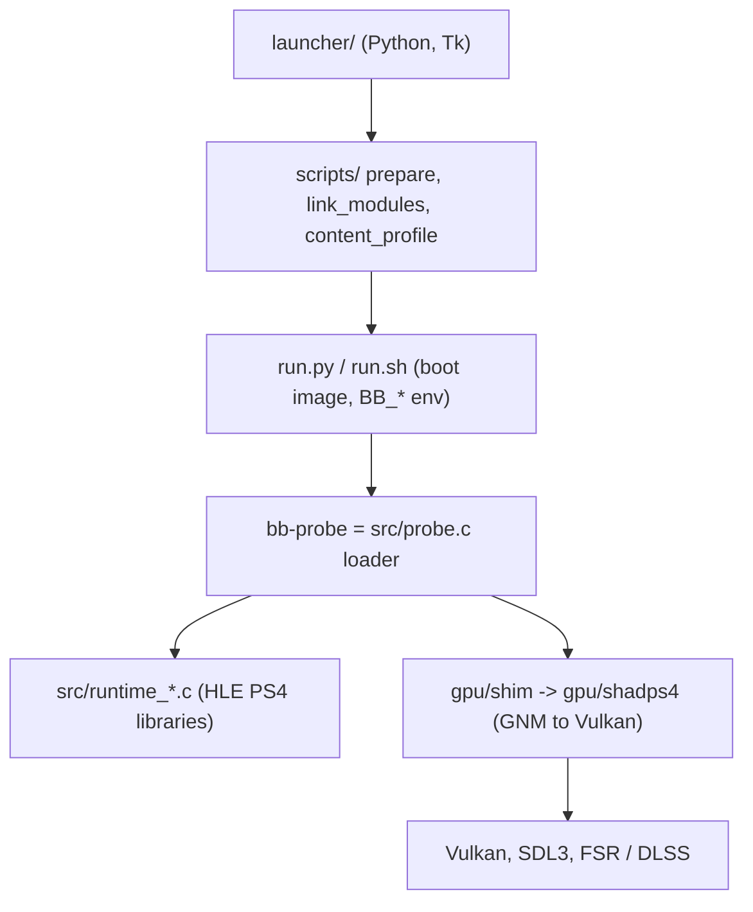

# Code map: uncharted_pc (fork)

- Repo: iannitram/uncharted_pc, a fork of Supermedo/uncharted_pc (C, C++20, Python; GPL-2.0-or-later parts from shadPS4).
- Kind: a native port (not an emulator) that runs the decrypted PS4 build of Uncharted: The Nathan Drake Collection as an x86-64 image, with the PS4 system libraries reimplemented in C and GNM graphics translated to Vulkan through a vendored shadPS4 renderer. Ships a Python launcher.
- Integration branch: `linux` (not `main`). Describes commit: 359c888 (2026-10-31). `main` is meant as a copy of upstream (it also holds the two fixes of PRs #43 and #45, so it is 4 commits off upstream and does not fast-forward); it is the branch CI publishes releases from.
- Upstream: `Supermedo/uncharted_pc` (`upstream/main`). Upstream is 26 commits ahead of `linux` (0.3.10 and 0.3.11, head bbd1b3a, 2026-10-30); a trial merge on 2026-10-31 conflicted in 10 files, so it waits on #164. A second source, `spacepepperoni/uncharted_Linux`, is merged separately (last in #133, 0c68226; 13 commits ahead since). Code goes to either only as a PR I open from an `up*` branch (five open upstream on 2026-10-31); nothing else is posted.
- No game files, keys or RE output are in the repo; the user supplies a decrypted dump.
- Naming oddity: many file and variable names use `bbport` / `BB_*` / `bb-probe` because the code started as a Bloodborne port. `patches/Bloodborne.xml` is still Bloodborne's patch database and does not apply to Uncharted.

## Layout

| Path | What it owns |
|---|---|
| `src/` | The host runtime in C (about 10.9k lines). `probe.c` is the loader (ELF mapping, import resolution by NID, guest hooks, fault handling, MOVBE emulation); `runtime_*.c` is one file per PS4 library (memory, thread, fiber, mutex/rwlock/sema, file VFS, pad over SDL3, audio, AJM decode (an unsupported codec now returns an error, #56), display, savedata, trophy, rtc, services, content); `cpu_patch.c` and `red_zone.c` are code patching; `compat_win.c` has MinGW POSIX shims; `vulkan_smoke.c`. |
| `gpu/` | The renderer. `CMakeLists.txt` builds the GPU library and `bb-probe`. `shadps4/` is shadPS4 pinned to one commit (`VENDOR.txt`), with local edits marked `bbport:`; `shim/` is the port's own C++ layer (ImGui settings menu, window, async copy threads, overlay with RAM/VRAM stats, `bbport_toggles.h` runtime A/B switches read from `BB_TOGGLE_FILE` and `BB_TOGGLE2`, `bbport_movie.*` movie frames at a patched render size via `BB_MOVIE_SIZE`, `bbport_write_log.*`, `bbport_nan_guard.h`); `bbgpu.h` is the C ABI; `bbnet/` network glue for private co-op; `dlss_bridge/` optional NVIDIA DLSS bridge; `patches/fsr-vulkan/` patches applied to the FSR submodule; `tools/`; `third_party/` submodules. |
| `launcher/` | Python/Tk launcher: `uncharted_linux.py` (Linux GUI launcher: game choice, Add to Steam, Deck mode, update check) and `uncharted_launcher.py` (Windows GUI) with `uncharted_*.py` helpers (`art` incl. SteamGridDB library art, `fonts`, `i18n` and `i18n_extra` for the translated texts, `logs` with bug reports pointed at this repo's Issues, `widgets`); the Linux launcher has one Upscaling section, render heights from 540p up, a 45 FPS choice and controller prompts in Steam Deck mode; `bbport_*.py` helpers for Steam, Vulkan, i18n, assets and the older launchers (`bbport_launcher*.py`); `bb-launcher.sh`, desktop entry, icons, covers, fonts. | |
| `scripts/` | Python prep tools run by the launcher or `run.py`: `prepare.py`, `link_modules.py`, `link_libc.py`, `content_profile.py`, `patches.py`, `pkg.py`, `mods.py`, `cheats.py`, `trophies.py`, `render_720p.py`, `render_res.py` (render resolution above or below 1080p by byte-pattern patch of the display settings, from BilalReloaded's port; see the licence note in `PEERS.md`). |
| `PIPELINE.md`, `SPEC.md`, `AGENTS.fork.md`, `CHANGELOG.md`, `PEERS.md` | Our pipeline files (stage, 1.0 spec with the 2.0 pathway, short agent rules, decisions log, peer notes behind SPEC's `## Prior art`); upstream owns `README.md` and `docs/ROADMAP.md`. |
| `install.sh` | One-line Linux installer from the spacepepperoni fork (fetches that fork's latest AppImage; not our release channel). |
| `run.py`, `run.sh` | `run.py` builds the boot image, sets `BB_*` environment (per-game defaults in `fix_defaults()`), then starts `bb-probe`; `run.sh` is the older Bloodborne-era shell launcher. `BB_PREBUILT=1` is the packaged mode. |
| `build.sh` | Native build (Linux gcc/cc, or MSYS2 CLANG64 on Windows); `build.sh --test` compiles and runs the C and C++ tests. |
| `msys2-env.sh`, `shell.nix`, `packaging/default.nix` | Windows toolchain env; Nix shell. |
| `packaging/` | `linux/` (AppImage, `package.sh`, `AppRun`, desktop file), `windows/` (PyInstaller packaging, resources, DLSS/XeSS fetch scripts, READMEs), `appimage.sh`, `bbport-entry.c`. |
| `patches/Bloodborne.xml` | Community patch database (Bloodborne only). |
| `third_party/` | LibAtrac9, Vulkan-Headers submodules. |
| `tools/` | Dev helpers: frame A/B (`ab.sh`), `soak.sh`, stack and freeze tools, FSR4 capture and optimize scripts (`fsr4cap/`), name importers, `gpu_capabilities.c`. |
| `tests/` | C/C++ unit tests (`test_runtime.c`, `test_pad.c`, `test_sema.c`, `test_cpu_patch.c`, `test_eop_matcher.c`, shader and motion tests) `test_ajm.c`, and 33 Python `unittest` files (launcher, patches, pkg, mods, trophies, i18n, display, `render_res`, the small-buffers default, logs). |
| `docs/` | `ARCHITECTURE.md`, `LINUX_BUILD.md`, `BUILDING_LINUX.md`, `ROADMAP.md`, `upscaler.md`, `PKG.md`, `MODS.md`, `resolution.md`, `parallel_gpu.md`, `DEVELOPMENT_LOG.md` (and `.ru.md`), `docs/README.md`, `TEMPORAL_REVIEW_2026-10-01.md`, `keyboard-prompts.md`, `motion_vectors.md`, `DEPTH_ADAPTIVE_TAA.md`, `CHANGES_2026-10-0*.md`, `maps/overview.md` (older, longer index), `code-map.md` (this file), `notes/` (sync notes, e.g. the 2026-10-28 conflict table), `review-2026-10-24/` (code review with its own `CODE_MAP.md`, findings, and our delivery roadmap `ROADMAP-proposed.md`), Russian translations in `ru/`, `history/`. |
| `Research/` | Background research notes (architecture, upscaling, licensing, similar projects). |
| `.github/` | `workflows/build.yml` (the only workflow; `sync-upstream.yml` was removed in the 2026-10-28 sync), `ISSUE_TEMPLATE/` (bug report form). |

## How it fits together



- The decrypted game image is mapped and executed directly; imports are bound by scoped NID to `runtime_resolve()`, and an unresolved import stops the process rather than stubbing a fake success.
- Graphics: GNM command streams are translated by the vendored shadPS4 `video_core` and `shader_recompiler`; the port adds TAA, camera-motion, frame-generation inputs and FSR passes as host shaders (`gpu/shadps4/video_core/host_shaders/`, see `docs/upscaler.md`).
- Runtime knobs are `BB_*` environment variables or `bbport.ini` (frame stats, frame capture, toggles for A/B).
- Detail: `docs/ARCHITECTURE.md`.

## Where our work is

`git log upstream/main..HEAD` shows 330 commits and `git diff upstream/main...HEAD` is 207 files (+21,593 / -3,025); upstream is 26 commits ahead of `linux` at this snapshot (0.3.11; #164). About 134 of the 330 are ours; the rest come from the spacepepperoni fork's history (about 89 by its maintainer, 56 by one Deck contributor, 10 by Supermedo, the rest scattered). Our commits concentrate on:

| Area | Files |
|---|---|
| Docs: `docs/review-2026-10-24/` code review and cross-platform roadmap, `SPEC.md`, `ROADMAP.md`, `LINUX_BUILD.md`, `docs/history/`, `docs/ru/`, `Research/` | most of our changed lines |
| Launcher texts and per-game defaults: `launcher/uncharted_i18n*.py` (es, pt, fr, de, it, ja), `run.py` `fix_defaults()` with `tests/test_fix_defaults.py`, `scripts/pkg.py` overlap and chunked-copy fixes, `packaging/linux/package.sh` (ships `scripts/patches.py`) and `tests/test_linux_package_scripts.py` | few files |
| Patch handling: `scripts/patches.py`, `tests/test_patches.py` (per-executable third-party patches, `APP_VER` decides the external version, own-executable-only patches) | few files |
| Renderer fixes under `gpu/shadps4/` (nested indirect-buffer frame leak; `WAIT_ON_CE_COUNTER` guard and compute ring offset reset from PRs #45 and #43; `WAIT_ON_DE_COUNTER_DIFF` operands as in shadPS4 #5406, #67 / PR #162; texture-cache `CanContain` and stencil-format back-ports, #136 / PR #161) and FSR 3.1 defaults/protected-memory handling | about 300 changed lines |
| `src/runtime_trophy.c`, `src/runtime_thread.c` (`host_priority` compiled only on Windows, 4dd6034, so Linux `-Werror` builds pass), `src/runtime_ajm.c` with `tests/test_ajm.c` (#56), MXCSR test, `tests/test_eop_matcher.c`, `render_720p` tests | few files |
| Launcher and defaults from the 2026-10-28 PRs: 540p render height (#126 / PR #135), Uncharted 2 brightness-flicker fix on by default (#123 / PR #148, `tests/test_fix_defaults_small_buffers.py`), the new sync texts translated (#134 / PR #149) | few files |

Two stray commits ("index on ..." and "untracked files on ...") are stash artifacts from an experiment branch; leave them.

## Known gaps (from the tree)

- Upstream sync: 0.3.10 and 0.3.11 are not on `linux`; the merge conflicts in `README.md`, `gpu/patches/fsr-vulkan/README.md`, the buffer cache, `vk_graphics_pipeline.cpp`, `vk_pipeline_serialization.cpp`, `vk_rasterizer.cpp`, `launcher/uncharted_launcher.py`, `run.py` and `src/runtime_thread.c` (#164, taken first).
- Renderer: `ExpandImage` can copy a stale image over fresh data (#31) and `BUFFER_WBINVL1` is not lowered (#37); the equeue loop can lose a request (#35).
- No Windows or macOS CI job; CI runs `bash build.sh` only, so no test suite runs there.
- `.github/workflows/build.yml` still lists the removed `sync-upstream.yml` in `paths-ignore` and keeps its `workflow_call` entry (harmless leftovers).

## Build and test

Linux (per `docs/LINUX_BUILD.md` and `build.yml`; GCC 14+ is required for C++23, Debian trixie is what CI uses):

```sh
git submodule update --init --recursive
bash build.sh              # builds out/bb-probe and the GPU library
bash build.sh --test       # C and C++ tests
bash run.sh                # starts the game (BB_PREBUILT=1 for packaged builds)
bash packaging/linux/package.sh   # AppImage and tarball
```

Python tests are `unittest` files in `tests/`, importing the scripts through `tests/paths.py`; no runner command is stated in the repo, so use `python3 -m unittest discover -s tests`.

Needs Vulkan, SDL3, fmt, Boost, tsl-robin-map, VMA, xxhash, Zydis, FFmpeg libraries, protobuf, nlohmann-json, OpenSSL, zlib, miniupnpc and glslang (the exact list is in `build.yml`).

CI: `build.yml` (runs on pushes to `main` and on every pull request; a push straight to `linux` is not built; job `build` in a `debian:trixie` container on ubuntu-latest: install dependencies, `build.sh`, package, upload the AppImage and tarball, and create a release on `main`); it skips doc-only changes. There is no automatic upstream merge any more (`sync-upstream.yml` was removed, 018aa69): the Project Manager merges upstream at day start, and a conflict becomes an `upstream-sync` issue. CI does not run `build.sh --test` or the Python tests.

## Planned (player tools, Window 3)

| Piece | Status | Where | Notes |
|---|---|---|---|
| Location and crash line | planned (#168) | `src/runtime_savedata.c`, `src/probe.c`, `CRASH_MARKERS` in `launcher/uncharted_linux.py` | `<saves folder>/where.json` = `{"game","title","subtitle","detail","saved_at"}` from the save param on each save (temp file + rename). The crash line is `Crash: kind=<assert\|fault\|exception> where=<offset or file:line> text=<up to 200 chars>`. Only the save strings the player sees (M9). |
| Known issues and matcher | planned (#169; entries #175) | `launcher/uncharted_known_issues.py`, `launcher/known_issues.json`, `tests/test_known_issues.py` | `load(path)`, `match(crash_line, game, location, entries)`. Entry: `id`, `signature` (substring), `game` (`u1`/`u2`/`u3`/`any`), `locations`, `summary`, `fixed_in`, `toggle` (`{key, value}`), `issue`. An entry with locations beats one without. |
| After-crash screen | planned (#176) | `launcher/uncharted_linux.py`, `launcher/uncharted_launcher.py`, `launcher/bbport_launcher_win.py`, `launcher/uncharted_logs.py` | A known issue gets "Turn on <fix> and play again"; an unknown one gets a pre-filled report with the chapter. In Game Mode it shows on the next start. |
| Playthrough log | planned (#170) | `launcher/uncharted_playthrough.py`, `tests/test_playthrough.py` | `<saves folder>/playthrough.jsonl`, one line per run: `build`, `game`, `chapter`, `preset`, `avg_fps`, `ended`, `at`; `summary()` per game. M1-M3 evidence. |
| Hardware probe and gates | planned (#171) | `launcher/bbport_vulkan.py`, `tools/gpu_capabilities.c`, the Display pages | Video memory, RTX, shared memory, laptop discrete GPU, refresh rate, CPU instructions. Under 6 GB: no frame generation, nothing above 1080p. |
| Dump check | planned (#172) | `scripts/dump_check.py` (reuses `sfo()` from `scripts/patches.py`), `tests/test_dump_check.py` | Layout, ELF vs encrypted SELF, CUSA and APP_VER (1.00 expected). Headers only (M9). |
| Benchmark mode | planned (#173) | `src/runtime_pad.c`, `gpu/shim/`, `run.py` | `BB_BENCHMARK=<seconds>`: fixed camera path, `<saves folder>/benchmark.json` with p50/p95/p99 frame times, `avg_fps`, `vram_peak_mib`, `stalls_over_40ms`, `ended`. |
| Card picker and cards | planned (#174 picker, #177 page) | `launcher/uncharted_tune.py`, `tests/test_tune.py`; `build_display` in both launchers | `pick(device, bench)` gives `handheld30`, `balanced60`, `max` in the launcher's setting keys; a card under 95% of its target steps its preset down once. |
| Fixes by location | planned (#178) | `run.py` `fix_defaults()`, `gpu/shim/bbport_toggles.h` | A fix can list chapters; it turns on there and off elsewhere, live where the toggle allows. First: the U2 flicker fix (Nepal) and the #157 fixes. |
| Game Mode menu | after 1.0 (#167) | `gpu/shim/bbport_overlay.cpp`, `src/runtime_pad.c`, `launcher/` | The full-screen controller menu; takes over #10. |

## Planned (2.0 pathway, SPEC.md)

| Piece | Status | Where | Notes |
|---|---|---|---|
| Save-relay hook in the launchers | planned (#163, blocked by save-relay's CLI) | `launcher/uncharted_linux.py`, `launcher/uncharted_launcher.py`, `launcher/bbport_launcher_win.py` (the Play paths; the saves folder is `saves_for()` / `default_saves()`, `<game folder>/Saves`), a new save-relay manifest file | Before Play: `save-relay pull <game> --manifest <m> --saves-dir <d> --json`; after the game quits: `save-relay push ... --json`. One JSON line (`{"ok","command","data"|"error"}`). Exit 0 starts the game, including `offline` ("Playing offline: saves will upload next time."); exit 3 is `conflict`: show the prompt from `data.server` / `data.local`, then call again with `--resolve keep-server\|keep-local`; exit 4 (`not_set_up`, `auth_failed`, `credentials`) offers `save-relay setup` (password on stdin, never an argument); any other failure shows `error.message` and offers "Play with local saves". Contract: save-relay `docs/code-map.md` `## API shape`. Linux and Windows first; tests fake the CLI's JSON for pull, push, conflict and offline. |
| Android target | planned (2.0) | new platform layer beside `src/` and `gpu/` | Route from revvv991/uncharted-android and eladharels/uncharted_android: the game's x86-64 code through FEXCore, the rest native ARM64, Turnip on Adreno; controller input. Uses the same save-relay saves. |
| Mac target | planned (2.0) | new platform layer; Metal renderer in place of Vulkan | Route from bloodborne-native/bloodborne-mac: native Apple Silicon, a recompiled library built from my own dump, Metal renderer. First step toward iOS. |
| iOS target | planned (2.0, after Mac) | shares the Mac recompiler and Metal renderer | Route from bloodborne-native/bloodborne-ios: no JIT on iOS, so no FEX; recompiled library built on a Mac, Metal renderer, sideloaded, controller support. Limit: about 2 GiB of address space with a free Apple ID; more needs the paid Apple Developer Program. Ryxm-a/uncharted-ios (FEX with sideload JIT) is watched. |

## Mac / PC / Linux

- Linux x86-64 is the target of this branch and the only platform CI builds. Hardware testing (Steam Deck, handhelds) is manual. R04: a Linux machine must run the game before a sync is merged; CI proves only that it builds, and only for `main` and pull requests, not for plain pushes to `linux`.
- Windows: built with MSYS2 CLANG64 (`build.sh` branch for MINGW, `packaging/windows/`, `launcher/bbport_launcher_win.py`); the code carries Windows-specific paths in `src/compat_win.c`, `runtime_memory.c` and `runtime_thread.c`. No Windows CI job here.
- macOS: out of scope for 1.0 (research only, #55); a native Apple Silicon build is planned for 2.0 (see Planned), not a Wine or MoltenVK bundle of the Windows build.
- Android and iOS: planned for 2.0 (see Planned); nothing in the tree targets them yet.
- Shared saves (#163) must work across Linux (SteamOS) and Windows first; save-relay stores credentials in the platform's own store (Secret Service, Windows Credential Manager, macOS Keychain).
- Player tools (#165, #166): the Python parts (#169, #170, #172, #174) are platform-neutral. The crash line (#168), the probe (#171) and the benchmark (#173) need both the Linux and the Windows paths (`src/compat_win.c` faults, DXGI or Vulkan memory queries). The after-crash screen and the cards go in both launchers. On macOS (research only) nothing extra is needed until 2.0.
- Needs a Vulkan GPU; DLSS needs NVIDIA.

## Open-source pieces

shadPS4 (vendored GNM/Vulkan renderer and shader recompiler, GPL-2.0-or-later, pinned commit in `gpu/VENDOR.txt`, plus shadNet/np parts from shadp2p), FireBurn/FSR-Vulkan (FSR 3.1, submodule, patched), Dear ImGui (in-game menu), xbyak, magic_enum, miniz (submodules), LibAtrac9 (ATRAC9 audio), Vulkan-Headers, Vulkan Memory Allocator, SDL3 (window and input), FFmpeg (MP3 and video), Zydis (x86 decoding for patching), Protobuf, nlohmann-json, OpenSSL, miniupnpc (co-op networking), Tracy hooks in the shim, and optional NVIDIA DLSS/NGX and XeSS (fetched, not committed).
