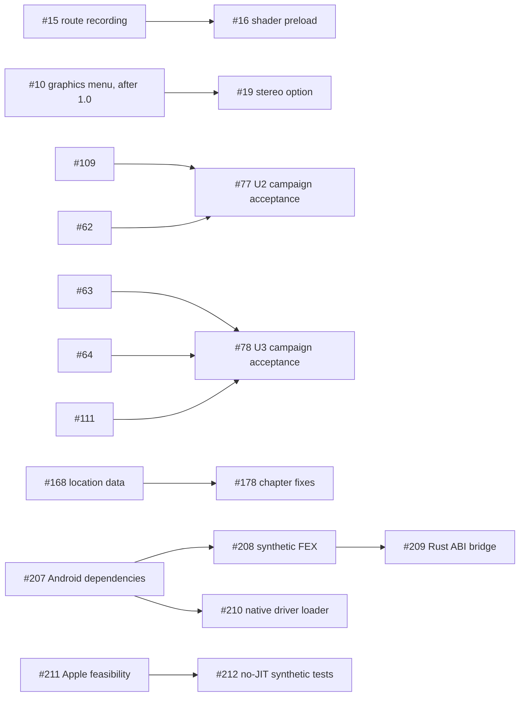

# Code map: Uncharted Universal

The intended shape of the repo for 1.0 (`SPEC.md`, approved 2026-11-01): **one Rust engine, two faces, one Rust runtime, three hubs; Windows and Linux/SteamOS for 1.0, with Mac, iOS and Android in 1.x**. Our launcher, preparation tools, core and host runtime are Rust. The adopted graphics engine stays C++ behind `gpu/bbgpu.h`; its language boundary is intentional. Linux and Windows execute x86-64 game code natively. The planned Apple route is an ARM64 library generated by AOT recompilation of x86-64 guest code, with an interpreter fallback and Metal; feasibility remains gated by #211 and iOS has no JIT. Android runs x86-64 game code through FEXCore on ARM64. The engine (`crates/core`) and faces (`app/` and `crates/cli`) describe the approved design, not a claim that those workflows are implemented.

Status per module: **present** (implemented in the tree), **partial** (only named functions/metadata exist; remaining behavior is listed), **stub** (types/signatures exist but behavior is `NotBuilt` or unimplemented), **planned** (not in the tree), **legacy** (today's C or Python, removed when its Rust replacement is present and the game boots). Synthetic tests exercise stated test seams only; they do not prove device or game behavior. "Musts" columns cite `SPEC.md` (M1-M20; the spec has no Should items); every module that replaces C or Python also serves M20. An issue that implements a module moves its status in the same PR. Integration branch: `main` (our work; `upstream-main` is a copy of Supermedo's `main`).

Source baseline: production `main` at [`ef27c862`](https://github.com/iannitram/Uncharted-Universal/tree/ef27c862dd15f60e64c51a1d285b96dec1be13b9); former upstream `8b66edc` is already its ancestor. `crates/runtime` is linked into the loader as a static library with runtime ABI version 1 (piece 3.01: its `build.rs` builds the NID table and `gpu/`). The target architecture below includes planned work: `app/` is a scaffold only (an empty Slint window, two placeholder buttons, keyboard and gilrs focus; piece 2.03), and `android/` and `apple/` do not exist. The CLI is a skeleton; `recipe::recipe_for`, preparation, linking, install and launch are stubs. Rust test fixtures and source-level checks do not establish Android, Apple, or full-game execution. See the [platform readiness audit](audits/2026-11-06-universal-platforms.md) and [PEERS.md](../PEERS.md).

## Merged foundations and what each still owes (2026-11-12)

These issues have their foundation on `main`; the issues stay open (or their module rows below stay partial) until the remaining work is done. None of them is device acceptance or platform completion.

| Issue | Merged in | Boundary on `main` and what remains |
|---|---|---|
| [#31](https://github.com/iannitram/Uncharted-Universal/issues/31) | PR #226 | Guards the `ExpandImage` copy with the fork's GPU-validity predicate and adds a synthetic regression target; handheld acceptance remains. |
| [#35](https://github.com/iannitram/Uncharted-Universal/issues/35) | PR #225 | Consumes equeue request signals under the mutex before `io_context.run()` and adds a 10,000-signal regression target; handheld Load Game acceptance remains. |
| [#37](https://github.com/iannitram/Uncharted-Universal/issues/37) | PR #224 (closed) | Corrects zero-operand decode and lowers both opcodes to device barriers with a synthetic regression target. |
| [#175](https://github.com/iannitram/Uncharted-Universal/issues/175) | PR #227 | 19 known-issue entries linked to player-posted crash logs, loaded by a test that reads the shipped file. |
| [#188](https://github.com/iannitram/Uncharted-Universal/issues/188) | PR #228 (closed) | Missing, malformed or unknown SFO title identity refuses with `BadDump`; title-to-region mapping and full prepare/start acceptance remain outstanding. |
| [#189](https://github.com/iannitram/Uncharted-Universal/issues/189) | PR #231 | Pairing, encrypted resumable transfer and safe staged cleanup foundations. Listener, discovery, serving/CLI wiring, Windows peer storage and device acceptance remain. |
| [#190](https://github.com/iannitram/Uncharted-Universal/issues/190) | PR #223 | Writes the five original artwork outputs from Rust. Deleting `launcher/uncharted_art.py` and its test once nothing calls them, and Windows packaging acceptance, remain. |
| [#206](https://github.com/iannitram/Uncharted-Universal/issues/206) | PR #232 | Bounded shared SELF/plain-ELF parsing and synthetic fixtures; this is not the prepare/link pipeline. |
| [#207](https://github.com/iannitram/Uncharted-Universal/issues/207) | PR #229, PR #255 | Pinned Android dependency recipe, synthetic native target and the vendored Turnip KGSL/FEX patch series. The Android SDK/NDK build was not run and the artifact is not a game APK. |
| [#211](https://github.com/iannitram/Uncharted-Universal/issues/211) | PR #230 | Feasibility matrix and owner-run checklist only. CPU/Metal probes were not run; this remains a partial, plan-only gate. |

Apple peer research is on local branch `research/apple-native-peers` / `6c246ba`; it adds bounded Mac-port references to `PEERS.md` and establishes no iOS no-JIT or Uncharted engine compatibility claim.

## Platforms (R04)

| Device family | 1.0 device | Game code | Renderer | Built on (hub) | Launcher | Save sync in | CI |
|---|---|---|---|---|---|---|---|
| Linux / SteamOS | the AMD handheld, the Strix Halo tablet | native x86-64 | shadPS4, Vulkan (RADV) | the Strix Halo tablet; the AMD handheld pulls | Slint app (AppImage), opened by the Steam shortcut | the launcher | `ubuntu-latest`: Rust workspace; Linux package in build.yml with the boot smoke test (3.01) |
| Windows | the RTX 3090 Ti desktop | native x86-64 | shadPS4, Vulkan | the desktop | Slint app | the launcher | `windows-latest`: Rust workspace; full GPU/runtime build pending (6.01) |
| macOS | a Mac with Apple silicon | planned ARM64 library generated from x86-64 guest code; interpreter fallback | Metal | the Mac | Slint app (also builds and installs the iOS app) | the launcher | `macos-latest`: Rust workspace as a CI build check only (the Mac app is 1.x); explicit runtime/application build pending (8.02); runner architecture must be verified |
| iOS / iPadOS | iPhone or iPad + controller | planned ARM64 library generated from x86-64 guest code; no-JIT interpreter fallback | Metal | the Mac, installed by cable | none: the game app | the game app (save-relay C interface) | `macos-latest`: runtime cargo check; signed application build pending (8.02) |
| Android | Adreno device + controller | FEXCore (x86-64 to ARM64) | shadPS4, Vulkan (Turnip) | the Strix Halo tablet | Slint app (Android) | the launcher, inside the same app | `ubuntu-latest`: runtime static-library cross-build; NDK/GPU/APK link pending (7.02) |

Rules that keep it portable: `crates/core` is pure Rust (no C library, no OpenSSL; the hub's crates are `mdns-sd`, RustCrypto `spake2`, `chacha20poly1305`, `sha2`, behind feature `hub`); no `std::os::*` outside `platform`, `steam` and the runtime's `os` module; every OS rule takes its folders from `platform::Vars`, so Linux, Windows and Mac rules are tested on every runner; tests build temporary folders under `std::env::temp_dir()`. The runtime is the only crate with `unsafe` and FFI (`crates/core` has `#![forbid(unsafe_code)]`), and each `unsafe` block carries a `// SAFETY:` line. Anything that must call a C library (the Vulkan hardware probe, SDL) lives in the runtime and reaches `crates/core` as data (a JSON report) or through a trait, never as a call.

## How it fits together


## Modules: `crates/core` (`uncharted_core`)

| Module | Status | Owns | Replaces | Musts |
|---|---|---|---|---|
| `error` | present | `Error` with stable `code()` and plain message per variant, `NotBuilt`, `Result` | | all |
| `platform` | present (#213) | `Os` (linux, windows, mac, ios, android), `Vars` (home, data, config from env lookup; Linux/Windows/macOS contracts tested independently of host), `AppDirs` (`<config>/uncharted-universal`, `<data>/uncharted-universal`: installs, backups, logs) | the folder code of `launcher/uncharted_linux.py` (`config_dir`, XDG folders) and `launcher/bbport_launcher_win.py` | M7, M11, M14, M20 |
| `sfo` | present | `param.sfo` reader, read-only and bounds-checked: `parse` to a key map of `SfoValue` (`Int` for format 0x404, else `Text`; any key, among them `TITLE_ID`, `APP_VER`, `VERSION`, `TITLE`), `text`, `app_version` (`APP_VER`, else `VERSION`); a bad signature, an offset or length past the end, an unterminated key or a non-4-byte integer is a plain `BadDump`, never a panic; never writes; covered by synthetic byte-fixture tests | `scripts/prepare.py` `sfo()` | M11, M20 |
| `games` | present (identity; revision gate fails closed) | `Game` (U1, U2, U3) with its key, name and executable (`eboot.bin`, `big2-ps4_Shipping.elf`, `big3-ps4_Shipping.elf`); the four collection title ids (`CUSA02320`, `CUSA02343`, `CUSA02344`, `CUSA02826`), one family shared by all three games, so a game is told by its executable; `title_region` rejects unknown IDs but leaves known IDs unmapped until verified `param.sfo` evidence; `SUPPORTED` stays empty until device runs; `check_revision` returns a plain `WrongRevision` refusal for every revision until then (issue #217) | `NDC_IDS`, `NDC_ELFS` in `scripts/patches.py`; `EXECUTABLES` in `run.py` | M11, M20 |
| `pkg` | present | `.pkg` container analysis and bounded safe extraction; encrypted entries skipped, delta packages refused | `scripts/pkg.py` | M11, M20 |
| `dump` | present | `DumpReport`, `check` (folder layout and decrypted executables); missing, unreadable or unknown `param.sfo` title identity fails closed with `BadDump` before a report is returned (#188) | new (#172; its Python brief is dropped, it is written in Rust) | M9, M11 |
| `content_profile` | present: offline metadata conversion and serialization, covered by synthetic tests; not wired to runtime | `from_sfo`, `to_bin` (the exact 28-byte `BBCONT01` record), `to_json` (pretty metadata with trailing newline); `Sku` is a probe setting, not a licence check | `scripts/content_profile.py` | M7, M20 |
| `link` | stub | `link_modules` and `link_libc`: module and libc import tables for the boot image | `scripts/link_modules.py`, `scripts/link_libc.py` | M7, M20 |
| `prepare` | partial: bounded SELF/plain-ELF `load_image` is present; prepare orchestration and boot-image linking are stubs | `Image` holds the mapped memory image, entry point, normalized ELF bytes and validated program headers; parser refuses unsupported or truncated required segments, invalid file/memory ranges and unmapped entries | Synthetic Rust parity and malformed-input tests; parser contract ported from `Supermedo/uncharted_pc` `scripts/prepare.py` at `8b66edc0192ea246ca63b360857402a0aa55626d` | M7, M11, M20 |
| `patches` | present | third-party literal patches per executable (`APP_VER` and title decide): `roxmltree` parse (8 MiB, 100,000-node, 64-depth bounds; DTD expansion and external resolution disabled), `applicable`, `select`, bounds-checked `compile` to the patch image, `about_list` for About; unsupported patch lines are retained as unavailable and discarded whole | external-patch half of `scripts/patches.py` | M7, M8, M20 |
| `mods` | stub | mod folder layouts (`dvdroot_ps4`, `app0/...`), overlay list for the runtime's file VFS | `scripts/mods.py` | M7, M20 |
| `cheats` | stub | cheat table `parse`, `compile` against the executable's hash, `apply` | `scripts/cheats.py` | M7, M20 |
| `trophies` | stub | the `.trp` reader and unlock log, read for the runtime (showing trophies in the launcher is after 1.0, #12) | `scripts/trophies.py` | M7, M20 |
| `render_size` | present (#277) | `game_res_env` derives `BB_GAME_RES` and heap variables; `parse_size`; `patch_image` (540p up, falls back to a smaller size that fits) and `deck_720p_patches` (720p Deck mode) find their sites by byte pattern and return `CheckedWrite` data (offset, expected bytes, new bytes); `apply_checked` refuses a write outside the image or over unexpected bytes with a plain error and writes nothing. Synthetic fixtures only | `scripts/render_res.py`, `scripts/render_720p.py` | M5, M13, M20 |
| `run_env` | present: covered by synthetic tests; not wired to the runtime | per-game defaults (`fix_defaults`: U1/U2/U3 readback, copy64 and `BB_TOGGLE2` values) and `build_env`: the `BB_*` environment from the device profile, settings and the player's own variables (player wins), the fixed renderer shader hashes, `BB_VBLANK_HZ` 60, U3 `BB_COPY64_EOP_READBACK`, U1 `BB_SKIP_COLLECTION_MENU`, `BB_GAME_RES` heaps via `render_size`; path-dependent variables (`BB_CONFIG`, `BB_USER_DIR`, saves) and the upscale preset sizes are not built here | `run.py` | M5, M7, M20 |
| `profile` | present | `DeviceProfile` (amd-handheld 20 W 30/60 Hz, strix-halo-tablet, desktop, mac, ios, android), `builtin`, `by_id`, `detect` (OS and CPU model name: Z1 Extreme and the Deck's custom APUs are the handheld, AI Max+ 395 the Strix Halo tablet) and `detect_with_os_release` (`ID=steamos` on Linux marks the handheld); the handheld's env is Deck mode's (`deck_environment`: 30 Hz, 1280x800, 720p render, Fifo, fullscreen, frame stats, Deck prompts, no upscaler or frame generation). Other profiles' values are starting points for the stage-5 device runs | Deck mode in `launcher/uncharted_linux.py` | M5, M13, M20 |
| `saves` | present | `save_root`/`user_dir` (per OS through `platform::Vars`; an existing `<install>/user` keeps its saves), `split_saves`, `is_synced` (only `SAVEDATA0N*` entries; never `where.json`, `save_slots.json`, `*.tmp`), the save slots (`select`, `copy`, `delete`, `mapping` ..), `relay_manifest(game)` (one save-relay format-1 manifest per game, `saves_from` launcher) and `relay_saves_dir` (the `--saves-dir`: the selected slot's folder, so the manifest follows the slot) | the save folders of `run.py` (`SAVE_FOLDERS`, `split_saves`), `scripts/save_slots.py` | M4, M18, M20 |
| `savecard` | stub | `SaveCard` (game, slot, picture from the save's `sce_sys/icon0.png`, title and detail from its `param.sfo`, file time, device, build id), `read_card`, `latest`, `side_by_side` | | M10 |
| `backup` | stub | `backup_saves`, `list`, `prune` (keep 10) | | M19 |
| `update` | stub | back up, re-prepare, recount saves | `launcher/uncharted_launcher.py` update check (`check_update`, `install_update`) | M19, M20 |
| `launch` | stub | `Relay` and `Runner` traits, `play` flow (pull, conflict with both `SaveCard`s, start runtime with `run_env`, push); desktop adapters use a child process, mobile apps embed the runtime and iOS does not require a subprocess | `main` of `run.py` | M7, M10, M18, M20 |
| `logs` | present: `crash_line`, known-issues matcher, playthrough; other functions stub | `redact` (no game paths or hex keys in logs), `crash_line` (reads the `Crash:` line the runtime prints, #168), the known-issues matcher over `crates/core/data/known_issues.json` (#169, seeded by #175), `playthrough.jsonl` (#170), log rotation, health and the report bundle | `launcher/uncharted_logs.py` and `crash_signature()` in `launcher/uncharted_linux.py`; the matcher and the playthrough log are new | M1-M3, M9, M20 |

Known-issue seed note (#175): the matcher now has 19 entries backed by player-posted crash logs, each linked to its upstream issue and scoped to the reported game/location. Signatures preserve reported assertion text or guest fault offsets; no addresses or workarounds are inferred.
| `recipe` | stub | `Target` (linux, windows, mac, ios, android), `Hub` (strix-halo, desktop, mac), `hub_for`, `serves`; `Recipe` and `recipe_for` (the prepare steps per target, including the Mac's recompile and the iOS build and cable install); the per-chapter fix list of #178 | | M11, M15 |
| `bundle` | present | `Bundle`, text manifest, sorted file hashing, verification and install; rejects game/dump content, device-owned data and unsafe relative paths; game-derived data uses a separate hub protocol and never enters this manifest | | M9, M11, M12 |
| `hub` | partial (feature `hub`) | Rate-limited SPAKE2 six-digit pairing helper with mutual confirmation; Unix mode-0600 peer file read/write; sealed XChaCha game-data transfer with authenticated direction/sequence, bounded manifests/chunks, hashes, ASCII-only paths (rejecting Unicode normalization ambiguity), case-fold-safe atomic staging, an incomplete marker, cross-process same-stage pull lock, and cleanup of generated temps only inside an ownership-marked reserved work directory; sequential resume; checked TCP home-network transport. A TCP service listener, mDNS discovery, bundle `serve`/`pull`, CLI wiring, and Windows ACL/atomic peer-file replacement remain unimplemented | | M11, M12 |
| `fleet` | stub | `DeviceRecord`, `drift` warning | | M12 |
| `vdf` | stub | Steam binary KeyValues `read`, `write` | `launcher/bbport_steam.py` | M13, M20 |
| `steam` | stub | `shortcut_app_id`, `Shortcut`, `upsert`, `userdata_roots`, `write_shortcut` (Steam closed, `.bak` kept), `write_artwork`; the shortcut opens the launcher's Continue screen (M13) | `launcher/bbport_steam.py`, the file writing of `launcher/uncharted_art.py` | M13, M20 |
| `artwork` | partial: names/sizes only | Steam grid paths and dimensions exist; source selection and image rendering are stubs. The Windows collection-art command writes the preserved reference images bundled in `crates/core/data/collection-artwork` (#190) | `launcher/uncharted_art.py` (`steam_artwork`, `cover`; the SteamGridDB download `steamgriddb_artwork` is dropped) | M13, M20 |
| `relay` | deferred external integration; reference only for now | [save-relay](https://github.com/iannitram/save-relay) owns sync on all five target platforms; attach its adapter when that repo's platform support and interface are ready. No sync implementation task is active; #163 is held at that dependency gate | #163, ROADMAP 9 | M18 |
| `tune` | present | parses the hardware report JSON (#171: GPU name/vendor/generation, dedicated/shared memory, selected integrated GPU and hybrid topology, refresh rate, CPU cores/instruction support); gates frame generation and sizes above 1080p below 6 GiB, DLSS on RTX, and warns on integrated selection in a hybrid machine; `upscalers` adds the DLSS and FSR rules on those gates (#147: DLSS on any RTX, DLSS Frame Generation on RTX 40 at 2x and RTX 50 up to 4x, FSR 4 on RDNA 3/4 and RTX 40/50, the default upscaler `dlss`, else `fsr3` only on the shim's measured FSR 3.1 device names, else `off`; the game's own probe keeps the final word); the three cards Handheld 30, Balanced 60, Max quality (#174: `pick` from the device; `pick_for`, the Settings page's entry point, keeps them to `upscalers`: the default upscaler, and a hidden frame generation such as DLSS's on an RTX 30 becomes FSR 3's at 120 Hz or more, else off). live collection is `uncharted-run --probe` in `crates/runtime`; benchmark report reading awaits the on-device runs of #173 | the report consumes the future runtime replacement of `launcher/bbport_vulkan.py`; the picker is new | M5, M13, M20 |

`vdf`, `steam`, `platform`, `bundle`, `hub`, `fleet`, `backup`, `update`, `launch` and the shape of `savecard` are copied from iannitram/totk-native (MIT) with credit in the file header, once built there. These are scaffolds until their functions stop returning `NotBuilt` and the platform workflows are integrated.

### Legacy behavior and Rust parity

Some requested features already exist in the legacy C/C++ and Python product. That does not mean the new Rust launcher/runtime has parity or that game/device acceptance is complete:

- Xbox controller glyphs are selected by the [legacy pad/GPU path](https://github.com/iannitram/Uncharted-Universal/blob/ef27c862dd15f60e64c51a1d285b96dec1be13b9/src/runtime_pad.c#L836-L843); #11 still needs visual checks in all three games. The Rust launcher/runtime route remains future parity work.
- Trophy queries, persistence and notices exist in the [legacy runtime](https://github.com/iannitram/Uncharted-Universal/blob/ef27c862dd15f60e64c51a1d285b96dec1be13b9/src/runtime_trophy.c#L143-L160) and [launcher](https://github.com/iannitram/Uncharted-Universal/blob/ef27c862dd15f60e64c51a1d285b96dec1be13b9/launcher/uncharted_launcher.py#L1778-L1807); #12 still needs an actual unlock and restart check. `crates/runtime::trophy` and launcher trophy integration are not yet ported.
- Plain ELF acceptance is implemented and synthetically verified in legacy [`scripts/prepare.py`](https://github.com/iannitram/Uncharted-Universal/blob/ef27c862dd15f60e64c51a1d285b96dec1be13b9/scripts/prepare.py#L35-L74); #66 was closed for that behavior. Rust `prepare::load_image` and linker parity remain tracked by [#206](https://github.com/iannitram/Uncharted-Universal/issues/206). Ten synthetic checks are parser evidence, not a completed prepare pipeline or game run.

## Modules: `crates/runtime` (`uncharted_runtime`)

Built as a static library linked into the loader binary while C remains; each Rust module exports the same `extern "C"` symbols as the C file it replaces (header generated by `cbindgen` into `crates/runtime/include/`). Order (ADR 0002): leaves first, loader last. Each step keeps `bash build.sh` and the boot smoke test green.

| Module | Status | Replaces (lines) | Tests from | Order | Musts |
|---|---|---|---|---|---|
| `abi` | ported (piece 3.01); ABI version 1 | `crates/runtime/src/abi.rs`, `abi/libc.rs`: the NID table (built by `build.rs` from `src/import_names.inc`), `runtime_resolve` and the libc contracts that were `src/runtime.c`; `include/uncharted_runtime.h` (cbindgen) is what `src/runtime.h` includes | `abi` unit tests, `tests/abi_stops.rs`, `tests/header.rs`, `tests/test_boot_smoke.py` | 1 | M20 |
| `time`, `rtc` | planned | `runtime_time.c` (29), `runtime_rtc.c` (155) | `test_runtime.c` parts | 2 | M20 |
| `sync` | planned | `runtime_sema.c` (185), `runtime_mutex.c` (263), `runtime_rwlock.c` (162) | `test_sema.c`, `test_sema.py` | 3 | M20 |
| `content`, `display` | planned | `runtime_content.c` (91), `runtime_display.c` (143) | `test_content.c`, `test_display.c`, `test_content.py`, `test_display.py` | 4 | M7, M20 |
| `trophy` | planned | `runtime_trophy.c` (327) | | 5 | M20 |
| `savedata` | present: metadata commit only; guest ABI and VFS pending | `runtime_savedata.c` (431, still legacy): `commit` atomically overwrites local `where.json` with only game, title, subtitle, detail and UTC saved_at (#168); not yet called by the guest runtime; `where.json` is per-device state; `saves::is_synced` excludes it | Rust `savedata` tests with made-up strings | 6 | M4, M9, M18, M20 |
| `audio` | planned | `runtime_audio.c` (323), `runtime_speakers.h` | `test_speakers.c` | 7 | M20 |
| `ajm` | planned | `runtime_ajm.c` (707) | `test_ajm.c` | 8 | M8, M20 |
| `file` | planned | `runtime_file.c` (631): VFS, mod overlay | `test_file_mods.c` | 9 | M7, M20 |
| `pad` | partial: the synthetic benchmark camera path only (#173, PR #236); SDL3 pad, gyro and rumble pending | `runtime_pad.c` (1235): SDL3 pad, gyro, rumble | `test_pad.c` | 10 | M13, M14, M20 |
| `benchmark` | partial: report contracts only (#173, PR #236): bounded config, frame-statistics accumulator and report writer; nothing reads `BB_BENCHMARK` or drives a game yet (wiring is #242) | new (AT3) | `crates/runtime/src/benchmark.rs` tests | 10 | M5, M20 |
| `services`, `kernel` | planned | `runtime_services.c` (678), `runtime_kernel.c` (351) | | 11 | M20 |
| `memory` | planned | `runtime_memory.c` (970): direct and flexible memory, mapping | | 12 | M8, M20 |
| `fiber`, `thread` | planned | `runtime_fiber.c` (363), `runtime_thread.c` (494) | | 13 | M20 |
| `cpu_patch`, `red_zone` | planned | `cpu_patch.c` (591), `red_zone.c` (489) | `test_cpu_patch.c`, `test_red_zone.c` | 14 | M20 |
| `os` | partial: positioned file I/O only; the other shims pending | `compat_win.c` (162): the MinGW POSIX shims become `cfg(windows)` code. `Description` keeps the sequential position itself and makes every host call positioned, so `pread`/`pwrite` leave it alone with no save-and-restore race (#39); not yet called by the guest file layer (3.09) | Rust `os` tests: two threads mixing sequential and positioned reads, and writes, on one descriptor (run on `windows-latest`) | 15 | M14, M20 |
| `loader` + bin `uncharted-run` | planned (the binary exists with only `--probe`) | `probe.c` (1474): ELF mapping, imports by NID, hooks, faults, MOVBE emulation; `crash::report` prints the one `Crash:` line (once per process) and `uncharted-run --force-fault` is its test hook (#168); the real fault and assertion handlers call it when this port lands | `test_probe.py`, the boot smoke | 16 | M7, M20 |
| `probe` (`uncharted-run --probe`) | partial: the hardware report; `gpu_capabilities.c`'s blit and `--live-resolution` checks not ported | `tools/gpu_capabilities.c` (the `bb-gpu-capabilities` program that `gpu/CMakeLists.txt` builds). `uncharted-run --probe` loads Vulkan at run time (`ash`), selects the game's device (`BB_GPU_ID` read as the game reads it, `s32(strtol(...))` with a 32-bit `long` on Windows and a 64-bit one elsewhere, else the renderer's ranking), and prints the #171 report for `core::tune`: vendor, driver device name, generation from that name, largest device-local heap (0 for a CPU renderer, whose heap is system RAM), integrated/shared and hybrid, CPU cores and `probe.c`'s CPU check; `refresh_hz` is null (no window). The `BB_BENCHMARK` report (#173, wired in #242) is written by `benchmark_run` in `crates/runtime`, fed by `pad` and the shim | Rust `probe` tests (ranking, `BB_GPU_ID`, generation names, CPU check, report keys); one run on lavapipe | with 16 | M5, M20 |
| `gpu` (build script) | planned | `build.sh` GPU part: builds `gpu/` with CMake through the `cmake` crate, links `bbgpu` | `test_*.cpp` stay C++ | with 1 | M6 |

`src/vulkan_smoke.c` is now `tests/test_vulkan_smoke.c`, the `vulkan-smoke-test` target of `gpu`'s build (piece 3.01). When `loader` is present, `src/` is deleted (M20). A bug fixed in C before its module moves is ported with the module.

## Faces

| Path | Status | Owns | Replaces | Musts |
|---|---|---|---|---|
| `crates/cli` (`uncharted-universal`) | stub | `check`, `prepare`, `play <game>`, `steam-add`, `patches`, `hub serve/pair/pull`, `fleet` (the Windows `Play Uncharted.exe`, `packaging/windows/play.c`, becomes `play`) | `run.py` command line, `packaging/windows/play.c` | M7, M11-M13, M18, M20 |
| `app/` (`uncharted-app`) | partial: scaffold only (2.03): Slint window titled "Uncharted Universal", a held place for the Continue screen (2.04), two placeholder buttons, the Slint royalty-free notice; builds and lints in CI on Linux, Windows and macOS; the full launcher is Rust + Slint for Linux, Windows, macOS and Android and will link `uncharted_core`, which the scaffold does not yet call | `launcher/*.py` | M7, M10-M13, M15, M17-M20 |
| `app/src/vm/` | planned | view models: `continue_page`, `first_run`, `saves`, `settings` (display cards from auto-tune #174), `fleet`, `about`, `after_crash` (closed #176 is replaced by roadmap 2.07) | | M1-M3, M10-M12, M18, M19 |
| `app/src/input.rs`, `app/src/focus.rs` | partial: gilrs d-pad/left stick/South button to `Nav` and activate, and the `FocusRing` the two buttons use; Android key events not yet | | M10, M17 |
| `app/ui/` | planned | `.slint` pages, controller first; texts in Slint's translation files (from `uncharted_i18n*.py`, `bbport_lang*.py`, seven languages) | `launcher/uncharted_widgets.py`, i18n files | M10, M20 |
| `docs/design/continue-screen.md` | planned | the Continue screen brief, shared with totk-native, for three games | | M10 |
| `docs/shadps4-triage.md` | present | per-game changes in `gpu/shadps4` against base `b4e7ae7`, with the hook each needs in the shared core (private half of shadPS4#17) | | M8 |

## Adopted code (stays in its own language)

| Path | Status | From | Owns | Musts |
|---|---|---|---|---|
| `gpu/` | present; selected fixes remain open | shadPS4 (pinned, `VENDOR.txt`) + the port's shim; FPS memory line adapted from Mevlock/uncharted_pc-dev cf02c6cff (#138) | GNM to Vulkan, shader recompiler, host passes, FSR, DLSS; FPS counter samples Linux/Windows process RAM and device-local VRAM (memory-budget extension or tracked VMA blocks and sparse arenas); Linux game screenshot pending; open import candidates #31 (ExpandImage) and #37 (BUFFER_WBINVL1 decode/barrier), plus the independent equeue fix #35 | M1-M3, M5, M8 |
| `android/` | partial: pinned dependency recipe and synthetic SDL link target | Selected FEXCore, Mesa Turnip, libadrenotools and SDL sources; recipe adapted from revvv991/uncharted-android (GPL-2.0-or-later) | `android/scripts/build_dependencies.sh` builds pinned public dependencies and links an authored smoke binary; APK project, FEX guest harness, runtime bridge and driver selection remain separate | M17 |
| `apple/` | partial: #211 source review and synthetic test plan only; CPU/Metal probes not executed; owner-run source and Apple hardware feasibility evidence remains outstanding | bloodborne-native/bloodborne-runtime, -mac, -ios (GPL-2.0 roots; exact files and dependency closure still need review before import; `bbnet20` GPL-3.0 is excluded) | target remains an x86-64-to-ARM64 AOT library, no-JIT fallback and Metal; no Uncharted executable coverage or Apple runtime is implemented | M15, M16 |

## Peer import plan

This is a bounded source-reuse plan, not a statement that peer code is already present. Each source link is pinned to the reviewed commit. The two shadPS4 fixes below are already tracked by #31 and #37; do not create duplicates. Production source baseline is `ef27c862dd15f60e64c51a1d285b96dec1be13b9`; former upstream `8b66edc0192ea246ca63b360857402a0aa55626d` is its ancestor, so there is no newer upstream batch to import.

| Reviewed source permalink | Proposed destination boundary | Current status | Issue | Dependency |
|---|---|---|---|---|
| [Legacy SELF/plain-ELF parser](https://github.com/iannitram/Uncharted-Universal/blob/ef27c862dd15f60e64c51a1d285b96dec1be13b9/scripts/prepare.py#L35-L74), [synthetic parser tests](https://github.com/iannitram/Uncharted-Universal/blob/ef27c862dd15f60e64c51a1d285b96dec1be13b9/tests/test_prepare.py#L54-L66) | Port the validated loader contract into `crates/core::prepare::load_image` and the Rust linker; preserve SELF/plain-ELF equivalence, bounds checks and refusal behavior | Legacy acceptance is present; ten authored synthetic checks passed for #66. Rust loader/linker are **not present** (stubs); no game-play claim | [#206](https://github.com/iannitram/Uncharted-Universal/issues/206) | Core scaffold only; prepare/link orchestration stays separate |
| [PR #5444 merged fix: ExpandImage guard](https://github.com/shadps4-emu/shadPS4/blob/699009c94932c64080391cf08d8131fc653ecee8/src/video_core/texture_cache/texture_cache.cpp#L549-L573) | `gpu/shadps4/video_core/texture_cache/texture_cache.cpp`: adapt the `HasGpuValidData` guard to this fork's `ImageFlagBits`; avoid copying stale CPU-dirty image contents during `ExpandImage` | **Not present** in production; import candidate only | [#31](https://github.com/iannitram/Uncharted-Universal/issues/31) | None; preserve refresh/copy semantics and add the issue's regression test |
| [PR #5447 merged fix: opcode formats](https://github.com/shadps4-emu/shadPS4/blob/6752d8b19ec5e7f68302e7b5bebedf5447c78eac/src/shader_recompiler/frontend/format.cpp#L4032-L4044), [barrier lowering](https://github.com/shadps4-emu/shadPS4/blob/6752d8b19ec5e7f68302e7b5bebedf5447c78eac/src/shader_recompiler/frontend/translate/vector_memory.cpp#L7-L14) | `gpu/shadps4/shader_recompiler/frontend/format.cpp` and `translate/vector_memory.cpp`: correct `BUFFER_WBINVL1*` operand metadata and lower to device-memory barriers | **Not present** in production; import candidate only | [#37](https://github.com/iannitram/Uncharted-Universal/issues/37) | None; add decode/lowering tests and run GPU test suite |
| [revvv Android build recipe](https://github.com/revvv991/uncharted-android/blob/847faf5a802253cf90664144765f0e5d12eb410e/android/scripts/build_all.sh#L1-L138), [component license map](https://github.com/revvv991/uncharted-android/blob/847faf5a802253cf90664144765f0e5d12eb410e/android/LICENSES.md#L1-L30), [pinned component lock](https://github.com/zenithblue-oss/shadps4-arm64/blob/be6bc2e9c60799e071dd2fafa6216e8d80ec619c/runtime/locks/components.lock.json#L1-L51) | New `android/` dependency/build scripts and component notices; build dependencies plus a small synthetic native artifact, not the full game APK | **Not present**; selected orchestration only, no full tree graft or game-derived files | [#207](https://github.com/iannitram/Uncharted-Universal/issues/207) | None; source/dependency pins and licenses must be recorded |
| [FEX synthetic guest harness](https://github.com/zenithblue-oss/shadps4-arm64/blob/be6bc2e9c60799e071dd2fafa6216e8d80ec619c/runtime/probes/fexcore-guest-harness.cpp#L330-L445), [build verifier](https://github.com/zenithblue-oss/shadps4-arm64/blob/be6bc2e9c60799e071dd2fafa6216e8d80ec619c/runtime/tests/verify-fexcore-guest-harness-build.mjs#L1-L86) | New Android NDK/bionic ARM64 synthetic test target; test register/vector state, callbacks, TLS, memory mapping and teardown without game-derived inputs | **Not present**; donor Linux/glibc harness must be adapted and Android-executed | [#208](https://github.com/iannitram/Uncharted-Universal/issues/208) | [#207](https://github.com/iannitram/Uncharted-Universal/issues/207); a Linux host pass alone is not Android execution |
| [FEX context/guest engine](https://github.com/zenithblue-oss/shadps4-arm64/blob/be6bc2e9c60799e071dd2fafa6216e8d80ec619c/src/core/fex/fex_guest_engine.cpp#L1281-L1515), [guest CPU adapter](https://github.com/zenithblue-oss/shadps4-arm64/blob/be6bc2e9c60799e071dd2fafa6216e8d80ec619c/src/core/guest_cpu/fex_guest_cpu.cpp#L49-L90), [HLE bridge](https://github.com/zenithblue-oss/shadps4-arm64/blob/be6bc2e9c60799e071dd2fafa6216e8d80ec619c/src/core/guest_cpu/fex_hle_bridge.cpp#L66-L109), [direct-port bridge comparison](https://github.com/revvv991/uncharted-android/blob/847faf5a802253cf90664144765f0e5d12eb410e/src/guest_cpu_fex.cpp#L235-L365) | New `crates/runtime` FEX module plus narrow C ABI glue for guest calls, callbacks, thread/fiber/TLS, faults and teardown; rework interfaces instead of importing either whole emulator | **Not present**; selected algorithms only; inspect transitive notices (including GPL-2.0-or-later local helpers) | [#209](https://github.com/iannitram/Uncharted-Universal/issues/209) | [#208](https://github.com/iannitram/Uncharted-Universal/issues/208), runtime 3.01 (stable C ABI), 3.12 (memory), 3.13 (thread and fiber); synthetic ARM64 ABI checks first |
| [libadrenotools driver API](https://github.com/bylaws/libadrenotools/blob/8fae8ce254dfc1344527e05301e43f37dea2df80/include/adrenotools/driver.h#L13-L31), [loader implementation](https://github.com/bylaws/libadrenotools/blob/8fae8ce254dfc1344527e05301e43f37dea2df80/src/driver.cpp#L19-L93), [Android Turnip build constraints](https://github.com/revvv991/uncharted-android/blob/847faf5a802253cf90664144765f0e5d12eb410e/android/scripts/port-arm64/build_turnip_android.sh#L1-L50) | New standalone `android/driver_loader.{h,cpp}` C ABI using BSD-2-Clause libadrenotools; require explicit system/custom choice and verify actual driver identity before Vulkan startup | **Not present**; no Slint dependency for the native loader; fail closed on missing/mismatched custom driver or silent system fallback | [#210](https://github.com/iannitram/Uncharted-Universal/issues/210) | [#207](https://github.com/iannitram/Uncharted-Universal/issues/207); app wiring can follow later |
| [AOT generator feasibility source](https://github.com/bloodborne-native/bloodborne-recomp/blob/c60ccf8be752b8690f2813505c4daf9eafdb136b/tools/recomp/recomp.sh#L1-L36), [no-JIT interpreter guard/tests](https://github.com/bloodborne-native/bbcpu/blob/3f9b6c1a11d5a443ee2e556a0d1f3aec4a73f0ca/src/cpu/jit_arm64.c#L25-L35), [Metal device example](https://github.com/bloodborne-native/bloodborne-runtime/blob/42736cf7ca7704b087e847482417d9f475bb2dd7/gpu/shadps4/video_core/renderer_metal/mtl_device.mm#L1-L15), [iOS synthetic Metal test](https://github.com/bloodborne-native/bloodborne-ios/blob/8f08be42c881c85051f2076c3721dbb2e273b025/app/metal_test.m#L1-L60) | Feasibility notes and owner-run checklist only: test whether AOT plus interpreter fallback and Metal can fit each game/device without keeping executable-derived data; audit file/dependency licenses, exclude GPL-3.0 `bbnet20` | **Not present**; research gate only, not a code import or claim of Uncharted coverage | [#211](https://github.com/iannitram/Uncharted-Universal/issues/211) | None; source/synthetic feasibility first, later owner device work only after a go decision |
| [bbcpu synthetic CPU tests](https://github.com/bloodborne-native/bbcpu/blob/3f9b6c1a11d5a443ee2e556a0d1f3aec4a73f0ca/tests/test_bbcpu.c#L1-L40), [no-JIT guard](https://github.com/bloodborne-native/bbcpu/blob/3f9b6c1a11d5a443ee2e556a0d1f3aec4a73f0ca/src/cpu/jit_arm64.c#L25-L35) | New Apple ARM64 synthetic interpreter coverage target; authored instructions and expected state only, no title signatures or executable-derived fixtures | **Not present**; test pattern/adaptation only, not a game CPU implementation | [#212](https://github.com/iannitram/Uncharted-Universal/issues/212) | [#211](https://github.com/iannitram/Uncharted-Universal/issues/211); outcome gates any later interpreter work |

All proposed peer code remains **not imported**. Build recipes, synthetic harnesses, or ABI probes can establish source/build/API compatibility only; none establish a playable Android or Apple build. The proposed Apple route remains gated at #211: AOT plus interpreter fallback and Metal, with no iOS JIT. Save-relay stays a pointer-only external dependency under #163 until its support/interface is ready; do not create local sync work ahead of that gate.

## Issue dependency index

### Foundation batch (2026-11-06)

These five independently buildable Rust foundations are the owner's selected
first implementation batch. Their current public type contracts already exist,
so none requires another issue in this batch to merge first. The consumer stages
below remain integration work; a completed module does not establish a working
launcher, prepared game or runnable platform. Module status changes land with
the corresponding implementation PR, not with this planning index.

| Foundation issue | Implementation | Later consumer |
|---|---|---|
| [#213 platform paths](https://github.com/iannitram/Uncharted-Universal/issues/213) | [PR #218](https://github.com/iannitram/Uncharted-Universal/pull/218) | Desktop configuration and install paths; mobile folders still come from the app. |
| [#217 game/revision contracts](https://github.com/iannitram/Uncharted-Universal/issues/217) | [PR #219](https://github.com/iannitram/Uncharted-Universal/pull/219) | Dump/preparation revision gate. Supported revision tables and region mappings still require verified evidence. |
| [#215 package analysis/extraction](https://github.com/iannitram/Uncharted-Universal/issues/215) | [PR #221](https://github.com/iannitram/Uncharted-Universal/pull/221) | Dump/package intake; encrypted content remains unsupported. |
| [#214 content profiles](https://github.com/iannitram/Uncharted-Universal/issues/214) | [PR #220](https://github.com/iannitram/Uncharted-Universal/pull/220) | Preparation metadata consumed by AppContent. |
| [#216 literal patch handling](https://github.com/iannitram/Uncharted-Universal/issues/216) | [PR #222](https://github.com/iannitram/Uncharted-Universal/pull/222) | Preparation writes and the launcher's patch listing. |

### Strict issue prerequisites

This index summarizes the 102 issues open in the 2026-11-06 snapshot. A listed issue edge means a genuine prerequisite for the dependent issue's stated acceptance; it does not imply that all investigation or implementation must wait. Roadmap stages, outside-project readiness, device checks, and local subtasks are shown separately below. Issues not listed as having an open issue predecessor had no such predecessor identified in this audit; that does not mean they are implemented, ready for every acceptance test, or in 1.0 scope. Do not infer dependencies from `Related` or `Part of` links, or make an issue depend on a task it owns.

| Prerequisite issue | Dependent issue | What the edge gates |
|---|---|---|
| [#15](https://github.com/iannitram/Uncharted-Universal/issues/15) | [#16](https://github.com/iannitram/Uncharted-Universal/issues/16) | Shader preload follows route recording; both are after 1.0. |
| [#10](https://github.com/iannitram/Uncharted-Universal/issues/10) | [#19](https://github.com/iannitram/Uncharted-Universal/issues/19) | Stereo option needs the after-1.0 graphics menu/profile. |
| [#109](https://github.com/iannitram/Uncharted-Universal/issues/109), [#62](https://github.com/iannitram/Uncharted-Universal/issues/62) | [#77](https://github.com/iannitram/Uncharted-Universal/issues/77) | U2 end-to-end handheld campaign acceptance; component work and test setup can proceed. |
| [#63](https://github.com/iannitram/Uncharted-Universal/issues/63), [#64](https://github.com/iannitram/Uncharted-Universal/issues/64), [#111](https://github.com/iannitram/Uncharted-Universal/issues/111) | [#78](https://github.com/iannitram/Uncharted-Universal/issues/78) | U3 end-to-end handheld campaign acceptance. #111 explicitly blocks #78; campaign work can proceed before final completion. |
| [#168](https://github.com/iannitram/Uncharted-Universal/issues/168) | [#178](https://github.com/iannitram/Uncharted-Universal/issues/178) | Location-based chapter fixes need runtime location data. This does not block unrelated auto-tune work in #166. |
| [#207](https://github.com/iannitram/Uncharted-Universal/issues/207) | [#208](https://github.com/iannitram/Uncharted-Universal/issues/208) | Android dependency build artifact for the synthetic FEX harness. |
| [#208](https://github.com/iannitram/Uncharted-Universal/issues/208) | [#209](https://github.com/iannitram/Uncharted-Universal/issues/209) | Validated synthetic FEX execution is a prerequisite for runtime guest-call bridge integration. |
| [#207](https://github.com/iannitram/Uncharted-Universal/issues/207) | [#210](https://github.com/iannitram/Uncharted-Universal/issues/210) | Android dependency/driver build; native driver loader work does not need Slint or the app shell. |
| [#211](https://github.com/iannitram/Uncharted-Universal/issues/211) | [#212](https://github.com/iannitram/Uncharted-Universal/issues/212) | Apple feasibility/license gate precedes synthetic no-JIT coverage. |



### Roadmap, external, and partial integration gates

These affect a milestone or part of acceptance, but are not additional numbered issue dependencies. A task may start against its current interface and finish integration when the named gate is ready.

| Work | Gate and start/completion distinction |
|---|---|
| [#20](https://github.com/iannitram/Uncharted-Universal/issues/20) | Steam launch and first-run stages 1.21/2.05 are integration context; documentation and standalone implementation can start before those app flows exist. |
| [#39](https://github.com/iannitram/Uncharted-Universal/issues/39) | Windows OS shim stage 3.15 is Windows-specific. It is not an Android/FEX bridge prerequisite. |
| [#72](https://github.com/iannitram/Uncharted-Universal/issues/72) | Requires the named owner decisions and roadmap 1.14/1.16/2.06 for its full profile/settings flow; it is not a prerequisite to unrelated core/runtime work. |
| [#163](https://github.com/iannitram/Uncharted-Universal/issues/163) | Hold sync implementation on external save-relay platform/interface readiness. The local `Relay` seam is only a contract ([`launch.rs`](https://github.com/iannitram/Uncharted-Universal/blob/ef27c862dd15f60e64c51a1d285b96dec1be13b9/crates/core/src/launch.rs#L39-L58)); do not open local sync tasks ahead of that external gate. |
| [#166](https://github.com/iannitram/Uncharted-Universal/issues/166) | Only location-selected auto-tune behavior waits on #168. The benchmark, dump check, cards and other settings work are separable; its 3.06/3.16 stages are integration/owner-device gates, not whole-issue start blockers. |
| [#168](https://github.com/iannitram/Uncharted-Universal/issues/168) | The issue owns savedata metadata work and can start now. [`savedata::commit`](https://github.com/iannitram/Uncharted-Universal/blob/ef27c862dd15f60e64c51a1d285b96dec1be13b9/crates/runtime/src/savedata.rs#L22-L65) writes local `where.json`; guest save ABI is not wired. The final `Crash:` line needs loader/fault integration at 3.16, not as a prerequisite to the metadata portion. |
| [#171](https://github.com/iannitram/Uncharted-Universal/issues/171), [#173](https://github.com/iannitram/Uncharted-Universal/issues/173) | Hardware-report parsing and benchmark/report contracts can be developed with fixtures. Live probe collection waits on loader stage 3.16; benchmark execution/integration waits on its runtime and scripted-input pieces. These gates do not block all Rust-side work. |
| [#178](https://github.com/iannitram/Uncharted-Universal/issues/178) | Only its location-driven behavior follows #168; recipe 1.24 and tune 1.27 are integration context for chapter fix selection. |
| [#185](https://github.com/iannitram/Uncharted-Universal/issues/185) | Playthrough writer work is done (closed #170); the remaining call belongs at Slint after-run stage 2.07. App lifecycle integration gates completion, not investigation or preparation. |
| [#188](https://github.com/iannitram/Uncharted-Universal/issues/188) | Its missing/unreadable/unknown-SFO refusal can be implemented locally; current [`dump.rs`](https://github.com/iannitram/Uncharted-Universal/blob/ef27c862dd15f60e64c51a1d285b96dec1be13b9/crates/core/src/dump.rs#L75-L104) records report problems rather than the requested `BadDump`/no-report result. The title-to-region map remains a completion criterion; it is not a dependency on #206 ELF parsing. |
| [#189](https://github.com/iannitram/Uncharted-Universal/issues/189) | This issue owns the hub/bundle transfer contracts; current [`hub`](https://github.com/iannitram/Uncharted-Universal/blob/ef27c862dd15f60e64c51a1d285b96dec1be13b9/crates/core/src/hub.rs#L38-L64) and [`bundle`](https://github.com/iannitram/Uncharted-Universal/blob/ef27c862dd15f60e64c51a1d285b96dec1be13b9/crates/core/src/bundle.rs#L45-L88) operations are stubs, not separate issue prerequisites. Fake-loopback transfer work can start before device acceptance. |
| [#191](https://github.com/iannitram/Uncharted-Universal/issues/191) | Measure readback cost with explicit environment values; this measurement does not depend on #192's default choice, since the environment can set the options for the benchmark. |
| [#198](https://github.com/iannitram/Uncharted-Universal/issues/198) | Applies only if this optional migration is selected; its external prerequisite [iannitram/shadPS4#41](https://github.com/iannitram/shadPS4/issues/41) is open, and is not this repository's local issue #41. This is not a project-wide blocker. |
| [#209](https://github.com/iannitram/Uncharted-Universal/issues/209) | In addition to #208, the bridge needs stable runtime C ABI 3.01, memory contract 3.12 and thread/fiber 3.13. Do not add Windows shim 3.15 as an Android prerequisite. |
| [#203](https://github.com/iannitram/Uncharted-Universal/issues/203), [#205](https://github.com/iannitram/Uncharted-Universal/issues/205) | These are review/governance trackers awaiting draft documentation PR #204; that review is not a code blocker. |

### Satisfied references and work that can start

Closed issue references are historical context, not active blockers: [#169](https://github.com/iannitram/Uncharted-Universal/issues/169)→[#175](https://github.com/iannitram/Uncharted-Universal/issues/175) (matcher/schema exists), [#139](https://github.com/iannitram/Uncharted-Universal/issues/139)/[#182](https://github.com/iannitram/Uncharted-Universal/issues/182)→[#184](https://github.com/iannitram/Uncharted-Universal/issues/184) (the `game_res_env` helper exists), [#170](https://github.com/iannitram/Uncharted-Universal/issues/170)/[#182](https://github.com/iannitram/Uncharted-Universal/issues/182)→[#185](https://github.com/iannitram/Uncharted-Universal/issues/185) (playthrough writer exists), and [#172](https://github.com/iannitram/Uncharted-Universal/issues/172)→[#188](https://github.com/iannitram/Uncharted-Universal/issues/188) (dump-check work exists). The remaining acceptance/integration belongs to each still-open issue. Likewise [#40](https://github.com/iannitram/Uncharted-Universal/issues/40), [#108](https://github.com/iannitram/Uncharted-Universal/issues/108), [#165](https://github.com/iannitram/Uncharted-Universal/issues/165) and #166 track outcome or completion; a parent tracker is not a prerequisite that blocks its child tasks from starting.

Selected build wave (2026-11-06): [#31](https://github.com/iannitram/Uncharted-Universal/issues/31) ExpandImage stale-cache fix; [#35](https://github.com/iannitram/Uncharted-Universal/issues/35) equeue request-loss fix; [#37](https://github.com/iannitram/Uncharted-Universal/issues/37) BUFFER_WBINVL1 decode/barrier lowering; [#175](https://github.com/iannitram/Uncharted-Universal/issues/175) known-issue data; and [#190](https://github.com/iannitram/Uncharted-Universal/issues/190) Rust artwork generator. PRs #224–#226 are merged; handheld/game acceptance is still outstanding. #175 uses the #169 schema but currently has only three evidence-backed contexts. #190 writes the five original artwork outputs byte-for-byte from bundled reference assets; Windows packaging remains unverified. #175 is short of its issue acceptance criteria. No change here claims device verification or issue completion.

Other ready candidates include #184 environment wiring, #189 hub/bundle transfer, and #207 Android dependencies. The bounded work for #188 (dump identity refusal) and #206 (SELF/ELF parsing) is merged, but their remaining region mapping, preparation/linking and start acceptance are still open. This #211 change records a plan-only Apple feasibility gate; CPU/Metal probes and owner-run Apple checks remain. [#121](https://github.com/iannitram/Uncharted-Universal/issues/121) is conditional: only if its reported fault reproduces on the handheld does it block [#77](https://github.com/iannitram/Uncharted-Universal/issues/77)/[#78](https://github.com/iannitram/Uncharted-Universal/issues/78) campaign acceptance.

## Legacy (removed by M20)

| Path | Removed when |
|---|---|
| `launcher/` (Python, Tk and GTK, about 11.7k lines), `launcher/bb-launcher.sh` | the Slint app has parity: Continue, first run, Settings, Add to Steam, update |
| `scripts/*.py`, `run.py`, `run.sh`, `install.sh` | every `crates/core` module listed above is present |
| `src/*.c`, `src/*.h` | `crates/runtime::loader` is present and the game boots |
| `packaging/windows/` PyInstaller, `packaging/linux/package.sh`, `packaging/appimage.sh`, `packaging/default.nix` | the release workflow builds the Rust app (piece 2.10) |
| C of ours that ships today: `packaging/bbport-entry.c` (the AppImage entry that clears Steam's `LD_PRELOAD`), `packaging/windows/play.c` (`Play Uncharted.exe`), `tools/gpu_capabilities.c` (`bb-gpu-capabilities`) | the Rust app cleans the environment itself (2.10), `uncharted-universal play` takes over `play.c`, `uncharted-run --probe` takes over `gpu_capabilities.c` (M20 allows no C of ours; `gpu/` stays) |
| `tests/test_*.py` (34 files), the C tests in `tests/` | their Rust ports are present; the `tests/*.cpp` files belong to `gpu/` and stay |

## Build and test

```sh
git submodule update --init --recursive
cargo build --workspace                 # core, cli, runtime today; `app` joins at piece 2.03; the runtime builds gpu/ through cmake when UNCHARTED_GPU_BUILD is set (piece 3.01)
cargo test --workspace
bash build.sh && bash build.sh --test   # the C path, until src/ is gone
```

CI (`.github/workflows/check.yml`) runs the Rust workspace (fmt, clippy, build, tests) on GitHub-hosted Linux, Windows and macOS runners on every push and pull request, and the iOS runtime check on macOS. Its `native-windows` job (a `windows-latest` runner with MSYS2 CLANG64) builds the GPU library and runs portable C harnesses plus GPU unit tests that do not need a Vulkan device; this is compile and CPU-test coverage, not Windows GPU or hardware coverage. For pull requests, `native-linux` calls `build.yml`, the Linux package workflow: it runs `bash build.sh --test`, enforces `tools/expected-test-skips.json`, runs the boot smoke test (`tests/test_boot_smoke.py`: a synthetic image boots through the Rust `abi` and exits cleanly), runs Vulkan tests and `vulkan-smoke-test` against Mesa lavapipe, and uploads package files with `manifest.json`, `SHA256SUMS`, dependency versions and the smoke output. That is software-only Vulkan coverage. Native macOS GPU/C coverage is still blocked: `src/probe.c` uses a Linux SysV stack trampoline and glibc `mallopt`, while `gpu/CMakeLists.txt` requires X11 and a Vulkan loader; `build.sh --test` has no supported macOS path. The macOS job covers only the Rust workspace. Android cross-builds only the runtime static library for `aarch64-linux-android`, without an NDK-linked application; iOS uses `cargo check`, not an app build. Signed mobile applications and boot smoke tests remain acceptance work; these checks do not prove full gameplay on any device.

## Build hubs (ADR 0004)

| Hub | Prepares for | Clients |
|---|---|---|
| the Strix Halo tablet | linux, android | the AMD handheld, the Android device |
| the RTX 3090 Ti desktop | windows | itself |
| the Mac | mac, ios | itself; the iPhone or iPad by cable |

A bundle holds the prepared install (boot image, linked modules, patches) and the GPU-independent shader translations, never game data (ruling (d), 2026-11-02), the dump's own files, keys or firmware. The hub copies the player's prepared game data folder to the player's own devices over the home network (SPEC.md M11, M12; ADR 0004). The owner ruled it in chat on 2026-11-02: "Copy between own devices." Issue #189 builds the copy. A driver pipeline cache travels only between devices with the same GPU and driver. Nothing leaves the home network.

## Not verified yet

- Which revision (`APP_VER`) of each game the port supports today; `games::SUPPORTED` is filled from the device runs.
- Which of the four collection title ids is which region or edition (`games::title_region`); the dump check (piece 1.05) fills it from real `param.sfo` files.
- Whether a PS4 save's `sce_sys/icon0.png` and `param.sfo` give a useful picture and detail for the save card; fallback: the game's own `icon0.png`.
- bloodborne-native's recompiler and Metal renderer: how much is Bloodborne-specific, and their licence files (`apple/` issue 8.01).
- FEXCore performance with our Rust runtime on Android (revvv991 measured the C runtime).
- mDNS from Game Mode and on Android (multicast lock).
