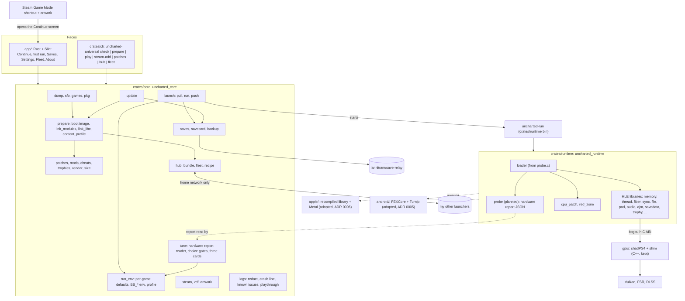

# Code map: Uncharted Universal

The intended shape of the repo for 1.0 (`SPEC.md`, approved 2026-11-01): **one Rust engine, two faces, one Rust runtime, three hubs, five platforms**. The engine (`crates/core`, library `uncharted_core`) checks my dump, prepares each game's install (boot image, linked modules, patches, render size), serves it to my other devices over the home network, writes the Steam shortcut with artwork, and wraps every start in a save-relay pull and push. The runtime (`crates/runtime`, `uncharted_runtime`) is the host side of the port, replacing `src/*.c` module by module (ADR 0002); it hands GNM work to the vendored shadPS4 renderer in `gpu/` (C++, kept) through `gpu/bbgpu.h`. The faces are the Slint launcher (`app/`, ADR 0003) and the `uncharted-universal` command line (`crates/cli`). Android runs the game's x86-64 code through FEXCore (ADR 0005); Mac, iPhone and iPad run a library recompiled on the Mac, drawn with Metal (ADR 0006).

Status per module: **present** (built), **stub** (the final types and signatures exist; constants and trivial pure helpers may be built, and any other function returns `Err(Error::NotBuilt(..))` or panics with "not built yet" when it cannot fail), **planned** (not in the tree), **legacy** (today's C or Python, removed when its Rust replacement is present and the game boots). "Musts" columns cite `SPEC.md` (M1-M20; the spec has no Should items); every module that replaces C or Python also serves M20. An issue that builds a module moves its status in the same PR. Integration branch: `main` (our work; `upstream-main` is a copy of Supermedo's `main`).

## Platforms (R04)

| Device family | 1.0 device | Game code | Renderer | Built on (hub) | Launcher | Save sync in | CI |
|---|---|---|---|---|---|---|---|
| Linux / SteamOS | the AMD handheld, the Strix Halo tablet | native x86-64 | shadPS4, Vulkan (RADV) | the Strix Halo tablet; the AMD handheld pulls | Slint app (AppImage), opened by the Steam shortcut | the launcher | `ubuntu-latest`: workspace (now); GPU library and boot smoke (piece 3.01) |
| Windows | the RTX 3090 Ti desktop | native x86-64 | shadPS4, Vulkan | the desktop | Slint app | the launcher | `windows-latest`: workspace (now); GPU library (CLANG64, piece 6.01) |
| macOS | a Mac with Apple silicon | recompiled library | Metal | the Mac | Slint app (also builds and installs the iOS app) | the launcher | `macos-latest`: workspace (now, an Apple silicon runner); the `aarch64-apple-darwin` runtime build (piece 8.02) |
| iOS / iPadOS | iPhone or iPad + controller | recompiled library (no JIT) | Metal | the Mac, installed by cable | none: the game app | the game app (save-relay C interface) | `macos-latest`: `cargo check` for `aarch64-apple-ios` (now); a real iOS build (piece 8.02) |
| Android | Adreno device + controller | FEXCore (x86-64 to ARM64) | shadPS4, Vulkan (Turnip) | the Strix Halo tablet | Slint app (Android) | the launcher, inside the same app | `ubuntu-latest`: `cargo build -p uncharted_runtime --target aarch64-linux-android` (now; the NDK joins at piece 3.01) |

Rules that keep it portable: `crates/core` is pure Rust (no C library, no OpenSSL; the hub's crates are `mdns-sd`, RustCrypto `spake2`, `chacha20poly1305`, `sha2`, behind feature `hub`); no `std::os::*` outside `platform`, `steam` and the runtime's `os` module; every OS rule takes its folders from `platform::Vars`, so Linux, Windows and Mac rules are tested on every runner; tests build temporary folders under `std::env::temp_dir()`. The runtime is the only crate with `unsafe` and FFI (`crates/core` has `#![forbid(unsafe_code)]`), and each `unsafe` block carries a `// SAFETY:` line. Anything that must call a C library (the Vulkan hardware probe, SDL) lives in the runtime and reaches `crates/core` as data (a JSON report) or through a trait, never as a call.

## How it fits together



## Modules: `crates/core` (`uncharted_core`)

| Module | Status | Owns | Replaces | Musts |
|---|---|---|---|---|
| `error` | present | `Error` with stable `code()` and plain message per variant, `NotBuilt`, `Result` | | all |
| `platform` | present (#213) | `Os` (linux, windows, mac, ios, android), `Vars` (home, data, config from env lookup; Linux/Windows/macOS contracts tested independently of host), `AppDirs` (`<config>/uncharted-universal`, `<data>/uncharted-universal`: installs, backups, logs) | the folder code of `launcher/uncharted_linux.py` (`config_dir`, XDG folders) and `launcher/bbport_launcher_win.py` | M7, M11, M14, M20 |
| `sfo` | stub | `param.sfo` reader: `parse` to keys (`TITLE_ID`, `APP_VER`, `VERSION`, `TITLE`), never writes | `scripts/prepare.py` `sfo()` | M11, M20 |
| `games` | present (identity; revision gate fails closed) | `Game` (U1, U2, U3) with its key, name and executable (`eboot.bin`, `big2-ps4_Shipping.elf`, `big3-ps4_Shipping.elf`); the four collection title ids (`CUSA02320`, `CUSA02343`, `CUSA02344`, `CUSA02826`), one family shared by all three games, so a game is told by its executable; `title_region` rejects unknown IDs but leaves known IDs unmapped until verified `param.sfo` evidence; `SUPPORTED` stays empty until device runs; `check_revision` returns a plain `WrongRevision` refusal for every revision until then (issue #217) | `NDC_IDS`, `NDC_ELFS` in `scripts/patches.py`; `EXECUTABLES` in `run.py` | M11, M20 |
| `pkg` | present | `.pkg` container analysis and bounded safe extraction; encrypted entries skipped, delta packages refused | `scripts/pkg.py` | M11, M20 |
| `dump` | present | `DumpReport`, `check` (folder layout, decrypted or not, which games and revisions), the early check before a prepare | new (#172; its Python brief is dropped, it is written in Rust) | M9, M11 |
| `content_profile` | present: offline metadata conversion and serialization, covered by synthetic tests; not wired to runtime | `from_sfo`, `to_bin` (the exact 28-byte `BBCONT01` record), `to_json` (pretty metadata with trailing newline); `Sku` is a probe setting, not a licence check | `scripts/content_profile.py` | M7, M20 |
| `link` | stub | `link_modules` and `link_libc`: module and libc import tables for the boot image | `scripts/link_modules.py`, `scripts/link_libc.py` | M7, M20 |
| `prepare` | stub | `prepare` a game folder into an install: boot image, linked modules, patches, render size; returns `InstallManifest` | `scripts/prepare.py` | M7, M11, M20 |
| `patches` | present | third-party literal patches per executable (`APP_VER` and title decide): `roxmltree` parse (8 MiB, 100,000-node, 64-depth bounds; DTD expansion and external resolution disabled), `applicable`, `select`, bounds-checked `compile` to the patch image, `about_list` for About; unsupported patch lines are retained as unavailable and discarded whole | external-patch half of `scripts/patches.py` | M7, M8, M20 |
| `mods` | stub | mod folder layouts (`dvdroot_ps4`, `app0/...`), overlay list for the runtime's file VFS | `scripts/mods.py` | M7, M20 |
| `cheats` | stub | cheat table `parse`, `compile` against the executable's hash, `apply` | `scripts/cheats.py` | M7, M20 |
| `trophies` | stub | the `.trp` reader and unlock log, read for the runtime (showing trophies in the launcher is after 1.0, #12) | `scripts/trophies.py` | M7, M20 |
| `render_size` | stub | render-size patches (540p up, 720p Deck mode) by byte pattern | `scripts/render_res.py`, `scripts/render_720p.py` | M5, M13, M20 |
| `run_env` | stub | per-game defaults (`fix_defaults`) and the `BB_*` environment from settings and the device profile | `run.py` | M5, M7, M20 |
| `profile` | stub | `DeviceProfile` (amd-handheld 20 W 30/60 Hz, strix-halo-tablet, desktop, mac, ios, android), `builtin`, `detect`, `by_id` | Deck mode in `launcher/uncharted_linux.py` | M5, M13, M20 |
| `saves` | stub | savedata root per game per device (`save_root`), `split_saves`, what travels (`is_synced`), `relay_manifest` for save-relay | the save folders of `run.py` (`SAVE_FOLDERS`, `split_saves`) | M4, M18, M20 |
| `savecard` | stub | `SaveCard` (game, slot, picture from the save's `sce_sys/icon0.png`, title and detail from its `param.sfo`, file time, device, build id), `read_card`, `latest`, `side_by_side` | | M10 |
| `backup` | stub | `backup_saves`, `list`, `prune` (keep 10) | | M19 |
| `update` | stub | back up, re-prepare, recount saves | `launcher/uncharted_launcher.py` update check (`check_update`, `install_update`) | M19, M20 |
| `launch` | stub | `Relay` and `Runner` traits, `play` (pull, conflict with both `SaveCard`s, run `uncharted-run` with `run_env`, push) | `main` of `run.py` | M7, M10, M18, M20 |
| `logs` | present: `crash_line`, known-issues matcher, playthrough; other functions stub | `redact` (no game paths or hex keys in logs), `crash_line` (reads the `Crash:` line the runtime prints, #168), the known-issues matcher over `crates/core/data/known_issues.json` (#169, seeded by #175), `playthrough.jsonl` (#170), log rotation, health and the report bundle | `launcher/uncharted_logs.py` and `crash_signature()` in `launcher/uncharted_linux.py`; the matcher and the playthrough log are new | M1-M3, M9, M20 |
| `recipe` | stub | `Target` (linux, windows, mac, ios, android), `Hub` (strix-halo, desktop, mac), `hub_for`, `serves`; `Recipe` and `recipe_for` (the prepare steps per target, including the Mac's recompile and the iOS build and cable install); the per-chapter fix list of #178 | | M11, M15 |
| `bundle` | stub | `Bundle` (target, build id, patch level, files with size and SHA-256, shader translations), `manifest`, `verify`, `install`; never the dump folder's own files (`is_forbidden`, a test enforces it); game data never travels in the bundle (ruling (d), 2026-11-02); the hub copies the prepared game data folder to the player's own devices over the home network (SPEC.md M11, M12; ADR 0004) | | M9, M11, M12 |
| `hub` | stub (feature `hub`) | `discover` (mDNS `_uncharted-universal._tcp`, private ranges only), `pair` (six-digit code, SPAKE2), `serve`, `pull` (sealed, resumable), `Transport` trait for loopback tests | | M11, M12 |
| `fleet` | stub | `DeviceRecord`, `drift` warning | | M12 |
| `vdf` | stub | Steam binary KeyValues `read`, `write` | `launcher/bbport_steam.py` | M13, M20 |
| `steam` | stub | `shortcut_app_id`, `Shortcut`, `upsert`, `userdata_roots`, `write_shortcut` (Steam closed, `.bak` kept), `write_artwork`; the shortcut opens the launcher's Continue screen (M13) | `launcher/bbport_steam.py`, the file writing of `launcher/uncharted_art.py` | M13, M20 |
| `artwork` | stub | Steam grid, wide grid, hero, logo, icon from each game's `sce_sys/pic0.png`, `pic1.png`, `icon0.png`; nothing downloaded | `launcher/uncharted_art.py` (`steam_artwork`, `cover`; the SteamGridDB download `steamgriddb_artwork` is dropped) | M13, M20 |
| `relay` | planned (feature `relay`) | save-relay adapter: links its library, maps outcomes to `launch::Sync` | #163 (reworked for Rust) | M18 |
| `tune` | present | parses the hardware report JSON (#171: GPU name/vendor/generation, dedicated/shared memory, selected integrated GPU and hybrid topology, refresh rate, CPU cores/instruction support); gates frame generation and sizes above 1080p below 6 GiB, DLSS on RTX, and warns on integrated selection in a hybrid machine; the three cards Handheld 30, Balanced 60, Max quality (#174). Live `uncharted-run --probe` collection awaits the runtime loader; benchmark report reading awaits #173 | the report consumes the future runtime replacement of `launcher/bbport_vulkan.py`; the picker is new | M5, M13, M20 |

`vdf`, `steam`, `platform`, `bundle`, `hub`, `fleet`, `backup`, `update`, `launch` and the shape of `savecard` are copied from iannitram/totk-native (MIT) with credit in the file header, once built there.

## Modules: `crates/runtime` (`uncharted_runtime`)

Built as a static library linked into the loader binary while C remains; each Rust module exports the same `extern "C"` symbols as the C file it replaces (header generated by `cbindgen` into `crates/runtime/include/`). Order (ADR 0002): leaves first, loader last. Each step keeps `bash build.sh` and the boot smoke test green.

| Module | Status | Replaces (lines) | Tests from | Order | Musts |
|---|---|---|---|---|---|
| `abi` | stub | `src/runtime.h` (125), `src/runtime.c` (266): the C ABI, NID resolution table (`import_names.inc`, 933, generated by `tools/import_names.py`), `runtime_resolve` | `test_runtime.c`, `test_runtime.py` | 1 | M20 |
| `time`, `rtc` | planned | `runtime_time.c` (29), `runtime_rtc.c` (155) | `test_runtime.c` parts | 2 | M20 |
| `sync` | planned | `runtime_sema.c` (185), `runtime_mutex.c` (263), `runtime_rwlock.c` (162) | `test_sema.c`, `test_sema.py` | 3 | M20 |
| `content`, `display` | planned | `runtime_content.c` (91), `runtime_display.c` (143) | `test_content.c`, `test_display.c`, `test_content.py`, `test_display.py` | 4 | M7, M20 |
| `trophy` | planned | `runtime_trophy.c` (327) | | 5 | M20 |
| `savedata` | present: metadata commit only; guest ABI and VFS pending | `runtime_savedata.c` (431, still legacy): `commit` atomically overwrites local `where.json` with only game, title, subtitle, detail and UTC saved_at (#168); not yet called by the guest runtime | Rust `savedata` tests with made-up strings | 6 | M4, M9, M18, M20 |
| `audio` | planned | `runtime_audio.c` (323), `runtime_speakers.h` | `test_speakers.c` | 7 | M20 |
| `ajm` | planned | `runtime_ajm.c` (707) | `test_ajm.c` | 8 | M8, M20 |
| `file` | planned | `runtime_file.c` (631): VFS, mod overlay | `test_file_mods.c` | 9 | M7, M20 |
| `pad` | planned | `runtime_pad.c` (1235): SDL3 pad, gyro, rumble | `test_pad.c` | 10 | M13, M14, M20 |
| `services`, `kernel` | planned | `runtime_services.c` (678), `runtime_kernel.c` (351) | | 11 | M20 |
| `memory` | planned | `runtime_memory.c` (970): direct and flexible memory, mapping | | 12 | M8, M20 |
| `fiber`, `thread` | planned | `runtime_fiber.c` (363), `runtime_thread.c` (494) | | 13 | M20 |
| `cpu_patch`, `red_zone` | planned | `cpu_patch.c` (591), `red_zone.c` (489) | `test_cpu_patch.c`, `test_red_zone.c` | 14 | M20 |
| `os` | planned | `compat_win.c` (162): the MinGW POSIX shims become `cfg(windows)` code | | 15 | M14, M20 |
| `loader` + bin `uncharted-run` | planned | `probe.c` (1474): ELF mapping, imports by NID, hooks, faults, MOVBE emulation; the `Crash:` line and forced-fault check (#168) await this port | `test_probe.py`, the boot smoke | 16 | M7, M20 |
| `probe` (`uncharted-run --probe`) | planned | `tools/gpu_capabilities.c` (the `bb-gpu-capabilities` program that `gpu/CMakeLists.txt` builds): GPU vendor, video memory and display as JSON for `core::tune` (#171; report contract and synthetic gate tests are present there, live collection awaits the loader); the `BB_BENCHMARK` report (#173) comes from `pad` and the shim | | with 16 | M5, M20 |
| `gpu` (build script) | planned | `build.sh` GPU part: builds `gpu/` with CMake through the `cmake` crate, links `bbgpu` | `test_*.cpp` stay C++ | with 1 | M6 |

`src/vulkan_smoke.c` (62) becomes a test in `gpu`'s build (piece 3.01). When `loader` is present, `src/` is deleted (M20). A bug fixed in C before its module moves is ported with the module.

## Faces

| Path | Status | Owns | Replaces | Musts |
|---|---|---|---|---|
| `crates/cli` (`uncharted-universal`) | stub | `check`, `prepare`, `play <game>`, `steam-add`, `patches`, `hub serve/pair/pull`, `fleet` (the Windows `Play Uncharted.exe`, `packaging/windows/play.c`, becomes `play`) | `run.py` command line, `packaging/windows/play.c` | M7, M11-M13, M18, M20 |
| `app/` (`uncharted-app`) | planned | the launcher, Rust + Slint, Linux, Windows, macOS, Android; links `uncharted_core` | `launcher/*.py` | M7, M10-M13, M15, M17-M20 |
| `app/src/vm/` | planned | view models: `continue_page`, `first_run`, `saves`, `settings` (display cards from auto-tune #174), `fleet`, `about`, `after_crash` (closed #176 is replaced by roadmap 2.07) | | M1-M3, M10-M12, M18, M19 |
| `app/src/input.rs` | planned | `Nav` from gilrs (desktop) and Android key events | | M10, M17 |
| `app/ui/` | planned | `.slint` pages, controller first; texts in Slint's translation files (from `uncharted_i18n*.py`, `bbport_lang*.py`, seven languages) | `launcher/uncharted_widgets.py`, i18n files | M10, M20 |
| `docs/design/continue-screen.md` | planned | the Continue screen brief, shared with totk-native, for three games | | M10 |

## Adopted code (stays in its own language)

| Path | Status | From | Owns | Musts |
|---|---|---|---|---|
| `gpu/` | present | shadPS4 (pinned, `VENDOR.txt`) + the port's shim | GNM to Vulkan, shader recompiler, host passes, FSR, DLSS; the review's GPU bugs (#31, #37) and the equeue wait (#35, in `gpu/shim`) | M1-M3, M5, M8 |
| `android/` | planned | revvv991/uncharted-android (GPL-2.0, credited) | APK project, FEXCore and Mesa/Turnip patches, libadrenotools glue, the `g2-arm64:` renderer changes rebased onto ours | M17 |
| `apple/` | planned; #211 source/synthetic gate reviewed, no-go for implementation or compatibility claims on U1/U2/U3 for macOS and iOS until owner-run evidence and approval | bloodborne-native/bloodborne-runtime, -mac, -ios (GPL-2.0 roots; exact files and dependency closure still need review before import; `bbnet20` GPL-3.0 is excluded) | target remains an x86-64-to-ARM64 AOT library, no-JIT fallback and Metal; no Uncharted executable coverage or Apple runtime is implemented | M15, M16 |

## Legacy (removed by M20)

| Path | Removed when |
|---|---|
| `launcher/` (Python, Tk and GTK, about 11.7k lines), `launcher/bb-launcher.sh` | the Slint app has parity: Continue, first run, Settings, Add to Steam, update |
| `scripts/*.py`, `run.py`, `run.sh`, `install.sh` | every `crates/core` module listed above is present |
| `src/*.c`, `src/*.h` | `crates/runtime::loader` is present and the game boots |
| `packaging/windows/` PyInstaller, `packaging/linux/package.sh`, `packaging/appimage.sh`, `packaging/default.nix` | the release workflow builds the Rust app (piece 2.10) |
| C of ours that ships today: `packaging/bbport-entry.c` (the AppImage entry that clears Steam's `LD_PRELOAD`), `packaging/windows/play.c` (`Play Uncharted.exe`), `tools/gpu_capabilities.c` (`bb-gpu-capabilities`) | the Rust app cleans the environment itself (2.10), `uncharted-universal play` takes over `play.c`, `uncharted-run --probe` takes over `gpu_capabilities.c` (M20 allows no C of ours; `gpu/` stays) |
| `tests/test_*.py` (34 files), the C tests in `tests/` | their Rust ports are present; the `tests/*.cpp` files belong to `gpu/` and stay |

## Build and test

```sh
git submodule update --init --recursive
cargo build --workspace                 # core, cli, runtime today; `app` joins at piece 2.03, and the runtime builds gpu/ through cmake at piece 3.01
cargo test --workspace
bash build.sh && bash build.sh --test   # the C path, until src/ is gone
```

CI (M6): `.github/workflows/check.yml` (fmt, clippy, build and test, with and without `--all-features`, on Linux, Windows and macOS; the runtime cross-builds for `aarch64-linux-android` and is checked for `aarch64-apple-ios`) and `build.yml` (the Linux package and release from `main`, until the Rust release workflow replaces it). Not in CI yet: the GPU library and its tests on Windows and macOS, and the boot smoke test.

## Build hubs (ADR 0004)

| Hub | Prepares for | Clients |
|---|---|---|
| the Strix Halo tablet | linux, android | the AMD handheld, the Android device |
| the RTX 3090 Ti desktop | windows | itself |
| the Mac | mac, ios | itself; the iPhone or iPad by cable |

A bundle holds the prepared install (boot image, linked modules, patches) and the GPU-independent shader translations, never game data (ruling (d), 2026-11-02), the dump's own files, keys or firmware. The hub copies the player's prepared game data folder to the player's own devices over the home network (SPEC.md M11, M12; ADR 0004). The owner ruled it in chat on 2026-11-02: "Copy between own devices." Issue #189 builds the copy. A driver pipeline cache travels only between devices with the same GPU and driver. Nothing leaves the home network.

## Not verified yet

- Which revision (`APP_VER`) of each game the port supports today; `games::SUPPORTED` is filled from the device runs.
- Which of the four collection title ids is which region or edition (`games::title_region`); the dump check (piece 1.05) fills it from real `param.sfo` files.
- Whether a PS4 save's `sce_sys/icon0.png` and `param.sfo` give a useful picture and detail for the save card; fallback: the game's own `icon0.png`.
- Apple AOT/Metal source compatibility is still unproven per title and target; see [ADR 0006 feasibility gate](adr/0006-apple-recompiled-metal.md#feasibility-gate-211-2026-11-06) and issue #211.
- FEXCore performance with our Rust runtime on Android (revvv991 measured the C runtime).
- mDNS from Game Mode and on Android (multicast lock).
